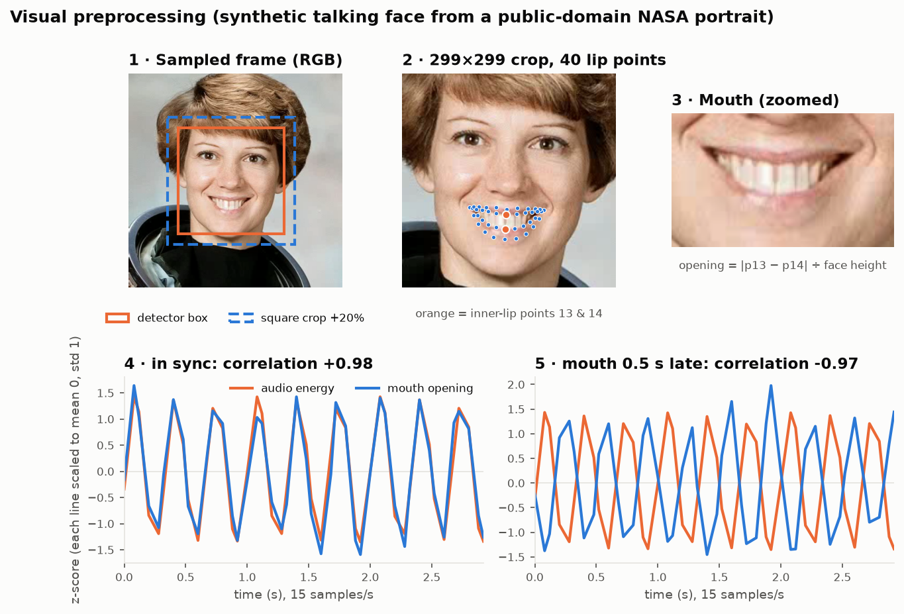
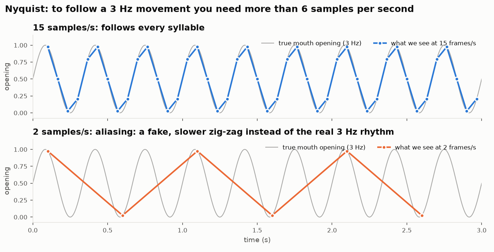
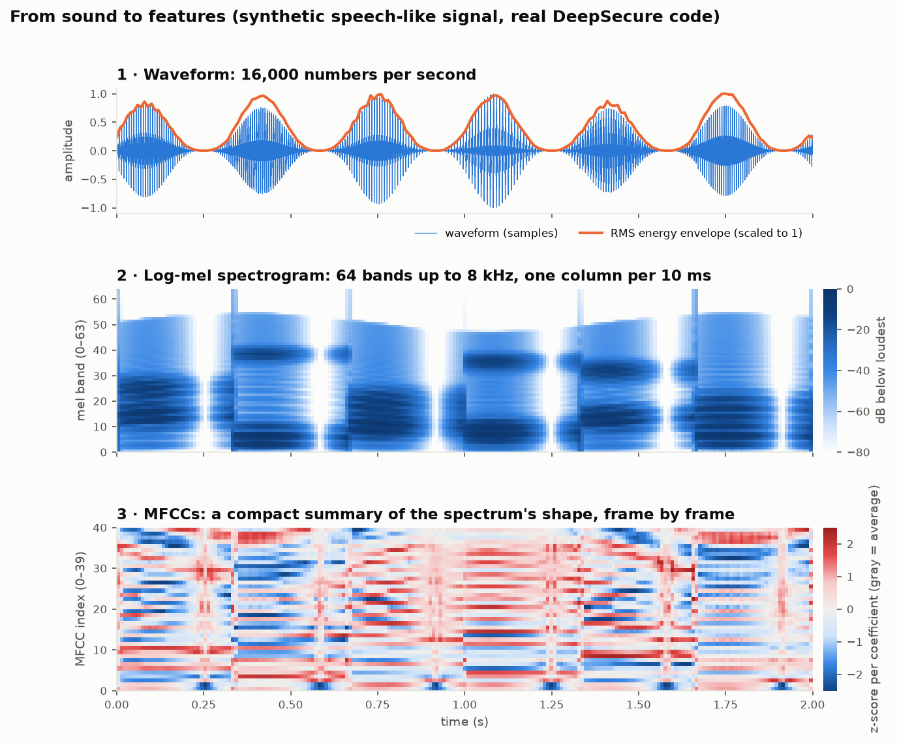
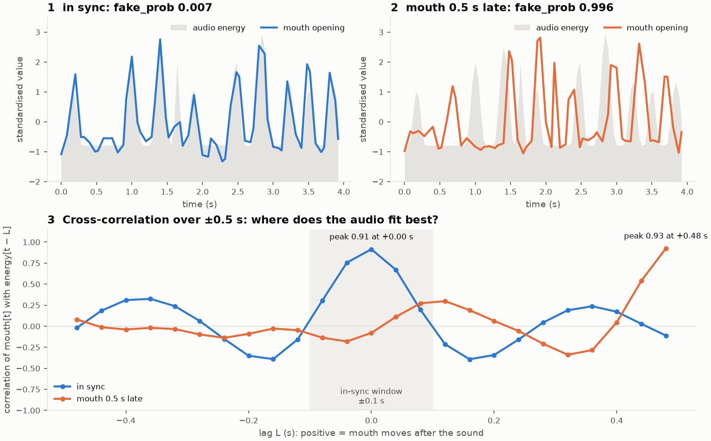
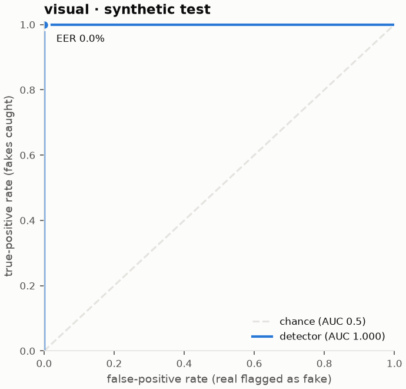
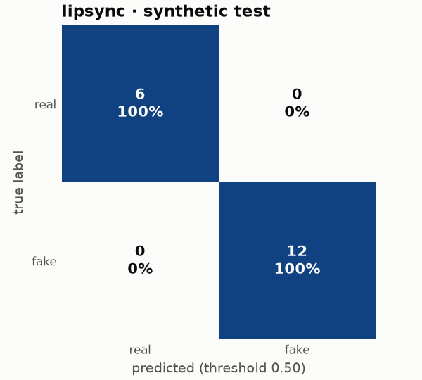
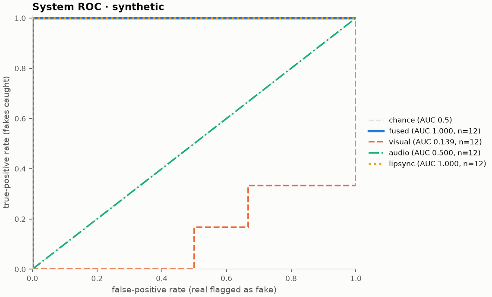

# DeepSecure — The Complete Guide

> Written for someone who knows basic Python and nothing else. This guide grows with
> every phase; sections not reached yet say so. Last updated: **Phase 3 (2026-10-16)**.

---

## 1. What DeepSecure is

**In five sentences.** DeepSecure is a program that looks at a video, audio or image file and
decides whether it's likely to be a deepfake. It checks three things independently: the
face (does it show signs of being swapped or re-animated?), the voice (does it sound
synthetic or cloned?) and the lip-sync (does the mouth move in time with the speech?).
It combines those three scores into one probability. A security layer then turns that
probability into a decision (SAFE, SUSPICIOUS or MALICIOUS), checks for unusual inputs
and recognises repeat attacks. Everything is shown in a web app, saved to a database and
exportable as a report.

**The full story.** Deepfake scams are no longer science fiction. A finance clerk gets a
video call from the "CFO" asking for an urgent transfer; a parent gets a voice note from
their "child" asking for money; a fraudster passes an online identity (KYC) check with a
generated face. Most research detectors look at just one signal (only the face, or only
the voice) and output a bare number like `0.83`. That has two problems:

1. **One signal is easy to beat.** A perfect face swap plus a cloned voice fools a face-only
   detector *and* a voice-only detector. But it's much harder to make the cloned voice
   line up exactly with the swapped mouth. Checking all three and how they agree is
   stronger than any one alone.
2. **A number isn't a decision.** A security analyst needs "block / review / allow", a
   reason, an audit trail, and a way to notice "we've seen this attack before".

DeepSecure addresses both: **multimodal detection** plus a **cybersecurity decision layer**.

```
 file ─▶ 1 INPUT ─▶ 2 PREPROCESS ─▶ 3 AI ANALYSIS ─▶ 4 FUSION ─▶ 5 SECURITY ─▶ 6 OUTPUT
                     validate,        visual CNN        weighted     risk level     web UI,
                     faces, audio     audio classifier  average      anomaly        HTML report,
                                      lip-sync model                 fingerprint    audit log
                                  every stage also writes to ─▶ 7 STORAGE (SQLite)
```

> ⚠ **Honesty note.** Until the models are trained on real deepfake datasets (Phase 4),
> the app runs in **demo mode** and its verdicts mean nothing. The app shows a banner
> saying so.

---

## 2. How to read this document

- **New to everything?** Read §3 (toolchain) and §4 (project tour) first, then §6
  (concepts) as you meet each idea.
- **Preparing for the viva?** Pair this file with `docs/VIVA_QA.md`.
- **Want to rebuild the project?** Follow `docs/IMPLEMENTATION_STEPS.md` command by command.
- Boxes marked **💡 Why does this exist?** explain the reason behind a design decision.
- `file.py:42` means "line 42 of file.py".
- Commands are for **zsh on macOS** and are always run from the repo root
  `~/Desktop/major_project` (the folder with `pyproject.toml`).

---

## 3. Toolchain from zero

### 3.1 The terminal and zsh
The terminal is a text interface to your computer. On macOS the default *shell* (the
program that reads what you type) is **zsh**. Useful basics:

| Command | Meaning |
|---|---|
| `pwd` | print the folder you're in |
| `cd ~/Desktop/major_project` | go to the project (`~` = your home folder) |
| `ls` / `ls -la` | list files (`-la` includes hidden ones like `.env`) |
| `cmd1 && cmd2` | run `cmd2` only if `cmd1` succeeded |
| `which uv` | show where a program lives |
| Ctrl + C | stop the running program (e.g. the Streamlit server) |

### 3.2 Python versions
Your Mac has **two** Pythons and that's fine:

- `/opt/homebrew/bin/python3` → Python **3.13** (installed by Homebrew; the project ignores it)
- `~/.local/share/uv/python/cpython-3.11.15…` → Python **3.11.15** (installed by uv; the project uses it)

**💡 Why 3.11 and not the newest?** ML libraries ship pre-compiled "wheels" for
specific Python versions, and the newest Python is often missing some. 3.11 is the most
widely supported version for torch + mediapipe + librosa together. `pyproject.toml`
says `requires-python = ">=3.11,<3.13"`, and `.python-version` contains `3.11` so uv
always picks it.

### 3.3 Virtual environments
A **virtual environment** (venv) is a private folder of installed packages for one
project. *Analogy:* each project gets its own toolbox, so upgrading a tool for project A
can't break project B. Ours is `.venv/` in the repo root. You almost never need to
"activate" it, because `uv run` uses it automatically. If you want to: `source .venv/bin/activate`
(and `deactivate` to leave).

### 3.4 uv
[uv](https://docs.astral.sh/uv/) replaces `pip`, `venv` and `pip-tools` with one fast tool.

| Command | What it does |
|---|---|
| `uv python install 3.11` | download a standalone Python 3.11 |
| `uv sync` | make `.venv` match `uv.lock` exactly (installs/removes packages) |
| `uv add librosa` | add a dependency to `pyproject.toml`, update `uv.lock`, install it |
| `uv add --dev pytest` | same, but into the `dev` dependency group |
| `uv remove X` | the reverse |
| `uv run <cmd>` | run a command inside the project venv (e.g. `uv run pytest`) |
| `uv pip list` / `uv pip show torch` | inspect what's installed |

**`uv.lock`** records the *exact* version of every package (including dependencies of
dependencies). Commit it. Anyone running `uv sync` gets an identical environment:
that's **reproducibility**.

**Dependency groups.** `[dependency-groups] dev` holds tools needed only for
development (pytest, ruff, watchdog). `uv sync` installs them by default.

> **Rule:** never `pip install` into this project. It bypasses the lockfile, so the
> next `uv sync` silently undoes it.

### 3.5 `pyproject.toml`, line by line

```toml
[project]
name = "deepsecure"                 # package name (import deepsecure)
version = "0.1.0"
description = "..."
readme = "README.md"                # shown on package pages; must exist or the build fails
requires-python = ">=3.11,<3.13"    # refuse to install on unsupported Pythons
dependencies = [ ... ]              # runtime libraries (see §3.6)

[dependency-groups]
dev = ["pytest", "pytest-cov", "ruff", "watchdog"]   # dev-only tools

[build-system]                      # how to build the package
requires = ["hatchling"]
build-backend = "hatchling.build"

[tool.hatch.build.targets.wheel]
packages = ["deepsecure"]           # the folder that IS the package

[tool.pytest.ini_options]           # pytest settings: where tests are, custom markers
[tool.ruff] / [tool.ruff.lint]      # linter settings: line length, which rule sets
```

**💡 Why a `[build-system]`?** With it, `uv sync` installs *our own* package into the venv
in "editable" mode, so `import deepsecure` works from anywhere, including from
`scripts/` and `tests/`. Without it, `uv run python scripts/x.py` fails with
`ModuleNotFoundError: No module named 'deepsecure'`.

### 3.6 What each library is for
| Library | Job in DeepSecure |
|---|---|
| torch, torchvision, torchaudio | neural networks (visual CNN, lip-sync Transformer) |
| timm | ready-made CNN architectures with pretrained weights (Xception) |
| mediapipe | find faces and 478 face landmarks |
| opencv-contrib-python (`cv2`) | read/write video frames, resize, colour conversion |
| numpy, pandas | arrays and tables |
| librosa, soundfile | load audio, compute MFCC/spectrogram features |
| pydub (+ ffmpeg) | pull the audio track out of a video |
| scikit-learn, joblib | classic ML (audio baseline, fusion head, Isolation Forest) and saving it |
| sqlalchemy | talk to the SQLite database |
| pydantic, pydantic-settings, python-dotenv | typed data contracts and settings from `.env` |
| streamlit | the web UI |
| jinja2 | HTML report templates |
| matplotlib | charts |
| pytest, pytest-cov, ruff, watchdog | tests, coverage, lint/format, Streamlit hot reload |

**Deliberately absent:** TensorFlow (would clash with PyTorch over protobuf/numpy),
facenet-pytorch (we already have a face detector), `opencv-python` (a second copy of
OpenCV that would overwrite `cv2`).

### 3.7 ffmpeg
A command-line program that can read and convert almost any audio/video format.
`pydub` calls it behind the scenes. Installed with `brew install ffmpeg`; check with
`ffmpeg -version`.

### 3.8 git basics
git records snapshots ("commits") of your code. The repo was initialised with
`git init -b main`. Daily use:

```bash
git status                 # what changed
git add -A                 # stage everything (the .gitignore keeps data/models/.env out)
git commit -m "Phase 0: foundations"
git log --oneline          # history
```

`.gitignore` lists what git must never track: `.venv/`, datasets in `data/`, model
weights (`*.pt`, `*.joblib`, `*.tflite`, `*.task`), the database (`*.db`), `.env`, `logs/`.

---

## 4. Project tour

```
major_project/
├── pyproject.toml, uv.lock, .python-version   environment definition (§3)
├── README.md            quickstart
├── CLAUDE.md            rules for AI coding sessions
├── .env.example         template for local settings; copy to .env to override defaults
├── .gitignore           what git ignores
├── .streamlit/config.toml   Streamlit settings (telemetry off, 200 MB upload limit)
├── deepsecure/          THE PACKAGE (all reusable code)
├── scripts/             command-line tools you run by hand
├── tests/               automated tests
├── data/                raw datasets, processed features, demo samples (not in git)
├── models/              downloaded MediaPipe files + trained checkpoints (not in git)
├── reports/             generated metrics, plots, HTML reports
├── logs/                deepsecure.log (rotating)
└── docs/                documentation (you are here)
```

### Files that exist after Phase 0

- **`deepsecure/__init__.py`**: marks the folder as a package; holds `__version__`.
- **`deepsecure/config/settings.py`**: every tunable number in one place (frame rate,
  thresholds, weights...). Uses `pydantic-settings`, so any value can be overridden by an
  environment variable or `.env` line starting with `DEEPSECURE_`. `get_settings()`
  builds the object once and caches it. See §10.
- **`deepsecure/config/device.py`**: `get_device()` picks the hardware PyTorch runs on:
  NVIDIA GPU (`cuda`) → Apple GPU (`mps`) → `cpu`. On your M1 it returns `mps`.
- **`deepsecure/config/logging_config.py`**: `setup_logging()` sends log messages to
  the terminal and to `logs/deepsecure.log` (rotates at 5 MB, keeps 3 old files). It's safe
  to call repeatedly, which matters because Streamlit re-runs the app script constantly.
- **`deepsecure/exceptions.py`**: our own error types (`InvalidInputError`,
  `ModelNotTrainedError`, `AssetMissingError`) so code can catch *expected* failures
  without hiding real bugs.
- **`deepsecure/schemas.py`**: the data contracts: the exact shape of the data handed
  from one layer to the next (§5).
- **`deepsecure/preprocessing/mediapipe_assets.py`**: knows where the two MediaPipe
  model files live, gives a clear error if they're missing, and builds the face detector
  and face landmarker with the **Tasks API** (§6.3).
- **`deepsecure/utils/synthetic_media.py`**: generates tiny fake test media (tone WAVs,
  noise, a video of moving shapes, a corrupted file). Used by both the sample-clip script
  and the tests, so neither needs a real dataset.
- **`deepsecure/app/streamlit_app.py`**: the web UI. In Phase 0 it shows system status
  (device, model files, sample clips), the demo-mode banner and placeholder tabs.
- **`deepsecure/{models,fusion,security,storage,reporting}/`**: empty packages, filled
  in later phases.
- **`scripts/download_assets.py`**: downloads the two MediaPipe model files and proves
  they load.
- **`scripts/make_sample_clips.py`**: writes six demo files to `data/samples/`, each
  exercising a different path through the system (see the table in that script).
### Added in Phase 2

- **`deepsecure/data/`**: dataset scanners and leakage-safe splitting (§7.1):
  `splits.py` (generic helpers), `faceforensics.py`, `asvspoof.py`, `internal.py`.
- **`scripts/make_splits.py`**: builds `data/processed/splits/*.csv` for every dataset
  that's present, prints class balance, refuses leaky splits.
- **`scripts/demo_leakage.py`**: a toy experiment that *measures* how leakage inflates
  accuracy (§6.12); writes `reports/leakage_demo.csv`.
- **`scripts/download_assets.py --ff-splits`**: also fetches the official FF++ split lists.
- **`data/raw/internal/`**: `README.md` (how to collect the internal test set ethically),
  `metadata_template.csv`, and empty `real/` + `fake/` folders.
- **Tests:** `test_splits.py`, `test_dataset_scanners.py`, `test_make_splits_script.py`.

### Added in Phase 3

- **`deepsecure/preprocessing/media_probe.py`**: ffprobe wrapper (streams, duration, corruption).
- **`deepsecure/preprocessing/input_validator.py`**: `InputValidator`, `sha256_of_file` (§7.2).
- **`deepsecure/preprocessing/frame_extractor.py`**: `FrameExtractor`, `square_crop_box`,
  `sample_frame_indices`, `LIP_LANDMARKS` (§7.2).
- **`deepsecure/preprocessing/audio_extractor.py`**: `AudioExtractor`, `summary_feature_names` (§7.2).
- **`deepsecure/utils/assets/nasa_portrait_face.jpg`** + `PROVENANCE.md`: a public-domain NASA
  portrait used to synthesise "talking face" clips with *known* lip-sync for tests and demos.
- **`deepsecure/utils/synthetic_media.py`**: + `syllable_envelope`, `write_talking_face_video`,
  `write_talking_face_clip`.
- **`scripts/plot_preprocessing.py`**: draws the three figures in `docs/img/`.
- **`scripts/make_sample_clips.py`**: + `talking_face_sync.mp4`, `talking_face_lag500ms.mp4`.
- **Tests:** `test_input_validator.py` (14), `test_frame_extractor.py` (13), `test_audio_extractor.py` (10).

### Added in Phase 3b (image input)

- **`deepsecure/preprocessing/image_loader.py`**: `load_image_rgb`, `inspect_image`, `ImageInfo`:
  the one place images are opened (format sniffing, pixel limit, EXIF rotation, RGBA → RGB) (§7.2).
- `InputValidator` (image branch), `FrameExtractor.extract_image`, an "images have no audio"
  guard in `AudioExtractor`; `ValidatedInput.width_px/height_px`; 3 new settings (§10).
- **`deepsecure/utils/synthetic_media.py`**: + `face_photo_rgb`, `write_face_photo` (optionally
  stored sideways with an EXIF tag, like a phone), `write_no_face_image`, `write_truncated_copy`.
- **Samples:** `face_photo.jpg`, `face_photo_phone.jpg`, `no_face.png`, `corrupted.jpg`.
- **Tests:** `test_image_input.py` (20). Pillow became a direct dependency (it was already
  installed through matplotlib/streamlit/torchvision).

### Added in Phase 4C (lip-sync baseline)

- **`deepsecure/models/base.py`**: the `BaseDetector` protocol all three detectors follow, and
  `unavailable()` for "can't judge this file" scores.
- **`deepsecure/models/lipsync_model.py`**: `LipSyncDetector` (cross-correlation baseline),
  signal helpers (`even_grid`, `mouth_on_grid`, `energy_on_grid`, `lag_correlations`),
  `uncalibrated_fake_prob`, and self-supervised calibration (`calibration_rows`,
  `fit_calibration`, `save_calibration`) (§7.4).
- **`scripts/calibrate_lipsync.py`**: "trains" the baseline from real talking clips (§8.6).
- **`scripts/plot_lipsync.py`**: draws `docs/img/lipsync_xcorr.png`.
- `schemas.py`: `LipSyncInput`; `ModalityScore.trained` and `.details`. 8 new settings (§10).
- `synthetic_media.py`: `speech_rhythm_envelope` (irregular, speech-like rhythm) and a
  `rhythm="periodic"|"speech"` option; the talking-face sample clips now use `"speech"`.
- **Tests:** `test_lipsync_model.py` (26).

### Added in Phase 4A (visual detector)

- **`deepsecure/models/visual_model.py`**: `VisualDetector` (Xception, top-k aggregation,
  agreement × decisiveness confidence, random-weight demo mode), `build_model` (with ResNet-50
  fallback), `input_config`, `crops_to_tensor`, `aggregate_probs`, `visual_confidence`,
  `save_checkpoint` (§7.4).
- **`deepsecure/models/visual_train.py`**: `FaceCropDataset`, `build_transforms`
  (augmentation), `train_visual` (frozen-head warm-up, weighted BCE, AdamW + cosine,
  video-level early stopping), `video_level`, `safe_auc`.
- **`scripts/prepare_faces.py`**: split CSV → face-crop PNGs + `index.csv` (or `--synthetic`).
- **`scripts/train_visual.py`**: fine-tunes and writes `models/visual/visual_best.pt` +
  `reports/visual_train_history.csv` (§8.7).
- **`deepsecure/models/small_faces.py`** + **`scripts/calibrate_small_faces.py`**: group
  photos (§8.18): `shrink`, `fit_table`, `small_face_z`, `group_fake_prob`; the script fits
  `models/visual/small_face_calibration.json` on validation faces and writes
  `reports/small_face_eval.csv` from test faces. Tiled scan: `tile_starts`, `merge_boxes`,
  `FrameExtractor._group_faces` (`test_group_photos.py`).
- `FrameExtractor.extract(..., with_lipsync=False)` (crops only); `synthetic_face_crops` toy
  real/fake crops; 11 `visual_*` settings (§10).
- **Tests:** `test_visual_model.py` (16), using timm's tiny `test_resnet` on the CPU.

### Added in Phase 4B (audio detector)

- **`deepsecure/models/audio_model.py`**: `AudioDetector`, `candidate_models` (logistic
  regression, MLP), `fit_balanced`, `evaluate`, `select_model`, `save_classifier` (§7.4).
- **`deepsecure/models/metrics.py`**: `compute_eer` (shared with Phase 4D).
- **`scripts/train_audio.py`**: parallel feature extraction with a cache, model selection on
  dev EER, `models/audio/audio_classifier.joblib` + `reports/audio_model_selection.csv` (§8.8).
- `synthetic_media.synthetic_voice` (toy bona fide / spoof voices); 4 `audio_*` settings.
- **Tests:** `test_audio_model.py` (12), including a fake ASVspoof folder run through the script.

### Added in Phase 4D (evaluation)

- **`deepsecure/models/metrics.py`**: + `binary_metrics` (accuracy, precision, recall, F1,
  ROC-AUC, EER, confusion counts); `compute_eer` now returns the midpoint threshold.
- **`deepsecure/models/evaluation.py`**: `EvalSet`, `eer_threshold`, `visual_video_scores`,
  `score_files` (internal set through the app's stages), `eval_sets_from_files`, `report_set`,
  `skipped_row` (§7.5).
- **`deepsecure/reporting/figures.py`**: `plot_roc`, `plot_confusion`.
- **`scripts/evaluate_models.py`**: test-split evaluation → `reports/modality_metrics.csv`,
  `roc_*.png`, `confusion_*.png`, `scores_*.csv` (§8.9).
- `audio_model.summary_features` (moved out of `train_audio.py`, now shared).
- **Tests:** `test_evaluation.py` (11).

### Added in Phase 5 (fusion)

- **`deepsecure/fusion/fusion_engine.py`**: `FusionEngine` (alias `MultimodalFusionEngine`):
  confidence-weighted average over available modalities, coverage × agreement × evidence
  confidence, disagreement warnings, demo warnings, optional learned head (§7.6).
- **`deepsecure/fusion/learned_head.py`**: `LearnedFusionHead` (logistic regression on
  per-modality log-odds + availability flags), `features_from_probs`, `features_from_frame`.
- **`scripts/train_fusion.py`**: weighted vs learned (grouped CV) vs single detectors →
  `reports/fusion_comparison.csv`; `--save` writes `models/fusion/fusion_head.joblib` (§8.10).
- `FusionResult` gained `available_modalities`, `coverage`, `agreement`, `max_fake_prob`,
  `max_modality`, `trained`, `warnings`; 3 new `fusion_*` settings; `score_files` now also
  records `group` and per-modality confidence; `synthetic_fusion_scores` toy table.
- **Tests:** `test_fusion.py` (17).

### Added in Phase 6 (cybersecurity layer)

- **`deepsecure/security/risk_scorer.py`**: `RiskScorer` (base level + escalation rules +
  decision trail), `raise_to`, `one_level_up`.
- **`deepsecure/security/anomaly_detector.py`**: `AnomalyDetector` (Isolation Forest + max-|z|
  view, calibrated on held-out real voices; 7 rules), `fit_forest`, `AnomalyResult`.
- **`deepsecure/security/fingerprint.py`**: `AttackFingerprinter`, `fingerprint_material`,
  `attack_fingerprint`, `InMemoryFingerprintStore` (distinct files per fingerprint).
- **`deepsecure/security/security_layer.py`**: `SecurityLayer.assess() -> SecurityAssessment`.
- **`scripts/fit_anomaly.py`**: fits the forest on real voices and reports flag rates (§8.11).
- `SecurityAssessment` gained `base_level`, `decision_trail`, `anomaly_codes`,
  `file_seen_count`; 12 security settings; `MOUTH_STATIC_REASON` in `lipsync_model.py`.
- **Tests:** `test_security.py` (24), including `test_boundary_values_use_lower_category`.

### Added in Phase 7 (storage and logging)

- **`deepsecure/storage/models.py`**: SQLAlchemy 2.x tables `Upload`, `ExtractedFeatures`,
  `DetectionResult`, `AttackFingerprintRow`, `AuditLog`; `UTCDateTime` (UTC in, UTC out).
- **`deepsecure/storage/repository.py`**: `Repository`: `session()` (commit/rollback),
  `save_analysis` (one transaction), `log_event` (own transaction), `record` (the Phase 6
  fingerprint-store interface), `results_frame`, `audit_frame`, `get_result`, `counts`,
  `purge_older_than`; `make_engine` (SQLite foreign keys + WAL), `feature_summaries`, `to_json`.
- **`scripts/show_db.py`**: counts, latest results and audit events, CSV export, retention purge.
- **Tests:** `test_storage.py` (12).

### Added in Phase 8 (pipeline, report, app)

- **`deepsecure/pipeline.py`**: `DeepSecurePipeline.analyze(path, original_name, progress)
  -> AnalysisResult` (report + frames + audio + scores), per-stage timing, failure containment,
  audit events; `close()` (§7.9).
- **`deepsecure/reporting/html_report.py`** + **`templates/report.html.j2`**: self-contained,
  autoescaped HTML report (`render_report`, `write_report`).
- **`deepsecure/reporting/figures.py`**: + `modality_bars`, `risk_gauge`, `mouth_energy_plot`,
  `figure_png`.
- **`deepsecure/app/streamlit_app.py`**: rewritten: Analyze / Results / Audit Log / About (§9).
- `ValidatedInput.original_name`; `.streamlit/config.toml` binds the server to `localhost`.
- **Tests:** `test_pipeline.py` (9), `test_report.py` (5), `test_app.py` (4, Streamlit AppTest);
  `isolated_models_dir` moved to `conftest.py`; the Phase 0 app test moved to `test_app.py`.

### Added in Phase 9 (integration testing and system evaluation)

- **`tests/test_pipeline_e2e.py`** (11): every edge case through the *production* pipeline
  (real Xception architecture, CPU), reports serialise to JSON and render to HTML, the database
  and audit log match what was analysed.
- **`deepsecure/models/system_eval.py`**: `run_files`, `method_metrics` (fused vs each detector,
  on available and common subsets, at the system's flagging threshold, plus verdict rates),
  `latency_table` (mean/p95 per stage, real-time factor).
- **`scripts/evaluate_system.py`**: internal set (+ `--faceforensics N`), `--benchmark`,
  `--synthetic` → `reports/system_eval.csv`, `latency.csv`, `system_rows_*.csv`,
  `roc_system_*.png` (§7.10, §8.13).
- `reporting/figures.plot_roc_overlay` (4 validated categorical colours + line styles).
- **Tests:** `test_system_eval.py` (6).

### Added in Phase 10 (final report and hardening)

- **`docs/FINAL_REPORT.md`**: the project report (abstract → references, acceptance checklist).
- `docs/VIVA_QA.md`: + 2-minute pitch and the 10 hardest panel questions; sections reordered.
- `reporting/figures.py`: thread-safe (object-oriented `Figure` + one lock) because Streamlit
  serves sessions from separate threads; `scripts/train_fusion.py` writes an explicit TBD row
  when there are no internal-set scores yet.
- This guide: §5 call-by-call walkthrough, §6.43–6.46 (neural networks and the training loop,
  Transformers and attention, pydantic validation, risk scoring).
- **Tests:** `test_app.py` + demo banner disappears with trained checkpoints; `test_report.py` +
  charts drawn from 8 threads at once.

### Added in the training phase (open data, 2026-10-17)
| File | What it does |
|---|---|
| `scripts/fetch_datasets.sh` | resumable, verified downloads: ASVspoof 2019 LA (+ official protocols), DeepFakeFace, RAVDESS actors 01–08 (MD5 vs Zenodo) |
| `scripts/import_asvspoof.py` | parquet → official folder layout; every row checked against the official protocol |
| `scripts/import_deepfakeface.py` | one real + one fake per person, fake resized to the real photo's size, both JPEG q90; person-grouped split CSV |
| `scripts/import_ravdess.py` | audio+video speech clips; actors 01–06 → lip-sync calibration, 07–08 → held-out test |
| `scripts/evaluate_audio.py` | AASIST (raw / trimmed) vs MFCC fallback on dev + eval, per attack; writes AASIST's dev threshold |
| `scripts/train_all.sh` | the whole recipe, step by step, skipping finished steps |
| `deepsecure/models/aasist_model.py` | pinned, hash-checked AASIST wrapper; 4 s windows with 50 % overlap |
| `deepsecure/models/third_party/aasist.py` | the authors' model code, vendored unmodified (MIT licence alongside) |
| `tests/test_training_data.py` | importers, AASIST wrapper and backend selection on tiny fake data |

### Phase 0 test files

- **`tests/conftest.py`**: *fixtures*: functions pytest runs to prepare inputs (here,
  synthetic media in a temporary folder).
- **`tests/test_settings.py`, `test_schemas.py`, `test_foundations.py`**: the 23 Phase 0
  tests.

---

## 5. End-to-end flow (the data contracts)

Everything below runs in one call, `DeepSecurePipeline.analyze()` in `deepsecure/pipeline.py`,
and every arrow is a typed object from `deepsecure/schemas.py`:

```
path ──InputValidator──▶ ValidatedInput  (sha256, duration, media type video|audio|image, has_audio_track)
        ├─FrameExtractor──▶ FrameBatch    (face crops 299×299, mouth-open sequence, landmarks)
        └─AudioExtractor──▶ AudioFeatures (16 kHz waveform, MFCC, log-mel, energy, summary vector)
FrameBatch ─VisualDetector──▶ ModalityScore(name="visual")
AudioFeatures ─AudioDetector─▶ ModalityScore(name="audio")
FrameBatch+AudioFeatures ─LipSyncDetector─▶ ModalityScore(name="lipsync")
3 × ModalityScore ─FusionEngine─▶ FusionResult (fused_fake_prob, confidence, weights_used)
FusionResult (+features) ─Security─▶ SecurityAssessment (risk level, anomalies, fingerprint)
everything ──▶ DetectionReport (report_id, timestamps, latencies, demo_mode, warnings)
```

**One upload, call by call.** Suppose an analyst uploads `call.mp4` (a 10 s video with sound):

1. `streamlit_app.run_analysis()` saves it as `upload.mp4` in a fresh temporary folder and calls
   `pipeline.analyze(path, original_name="call.mp4", progress=...)`.
2. `InputValidator.validate()`: extension, size, `sha256_of_file()`, `media_probe.probe()`
   (ffprobe), a real decode, duration → `ValidatedInput`. (A bad file stops here:
   `InvalidInputError` → audit event `input_rejected`.)
3. `FrameExtractor.extract()`: one pass through the video; `_face_crop()` (MediaPipe face
   detector, square + 20 %, 299×299) at 2 fps; `_mouth()` (MediaPipe landmarker) at 15 fps over
   the first 10 s → `FrameBatch`.
4. `AudioExtractor.extract()` → `load_waveform()` (ffmpeg via pydub, mono 16 kHz) →
   `features_from_waveform()` (normalise, trim with `offset_s`, MFCC/log-mel/RMS, summary) →
   `AudioFeatures`.
5. `VisualDetector.predict(frames)` (`crop_probs()` → `aggregate_probs()` top-5),
   `AudioDetector.predict(audio)` (scaler + classifier), `LipSyncDetector.predict(LipSyncInput)`
   (`features()` → `lag_correlations()` → score) → three `ModalityScore`s.
6. `FusionEngine.fuse(scores, "video")` → `FusionResult` (weights, coverage, agreement, warnings).
7. `SecurityLayer.assess()` → `AnomalyDetector.assess()`, `RiskScorer.score()`,
   `AttackFingerprinter.fingerprint()` + `Repository.record()` → `SecurityAssessment`.
8. `DetectionReport(...)`, then `Repository.save_analysis()` (one transaction) and audit events
   `analysis_started` / `analysis_completed`; every step's milliseconds are in
   `report.stage_latency_ms`.
9. Back in the app: `show_results()` draws the banner, `risk_gauge()`, `modality_bars()`,
   `mouth_energy_plot()`; `render_report()` builds the downloadable HTML. The temporary file is
   deleted when the `with tempfile.TemporaryDirectory()` block ends.

**💡 Why typed contracts instead of dicts?** With a dict, a typo like `"fake_porb"` or a
probability of `1.7` slips through and causes a wrong verdict three layers later. A
pydantic model rejects it immediately, at the exact place it was created. Try it:

```python
from deepsecure.schemas import ModalityScore
ModalityScore(name="visual", fake_prob=1.7, confidence=0.9)
# pydantic_core.ValidationError: fake_prob  Input should be less than or equal to 1
```

**The missing-modality rule.** If a detector can't run (an audio-only file has no face;
a silent video has no voice), its `ModalityScore` has `available=False` and a `reason`.
Fusion ignores it and rescales the remaining weights so they add up to 1. If *nothing*
is available, the verdict is SUSPICIOUS with "insufficient evidence", never SAFE.
*Analogy:* a security guard who couldn't see the visitor's face doesn't wave them
through; they say "I couldn't verify this".

---

## 6. Concepts primer

Each concept: **What it is · Analogy · Where DeepSecure uses it · Code pointer.**
Concepts are added in the phase that first needs them.

### 6.1 Virtual environment & lockfile
- **What:** an isolated set of installed packages (`.venv/`) plus a file pinning exact versions (`uv.lock`).
- **Analogy:** a recipe that says "Brand X flour, batch 2026-03", not just "flour".
- **Where:** the whole project; `uv sync` rebuilds `.venv` from `uv.lock`.
- **Code:** `pyproject.toml`, `uv.lock`.

### 6.2 Configuration via settings + environment variables
- **What:** keeping every tunable number in one typed object, overridable from outside the code.
- **Analogy:** a thermostat's settings panel; you change the temperature without rewiring the house.
- **Where:** thresholds, weights, sample rates, paths. Override with e.g.
  `DEEPSECURE_MAX_FRAMES=16 uv run streamlit run deepsecure/app/streamlit_app.py`.
- **Code:** `deepsecure/config/settings.py`.

```python
from deepsecure.config.settings import get_settings
s = get_settings()
s.risk_thresholds.malicious      # 0.7
s.fusion_weights.as_dict()       # {'visual': 0.45, 'audio': 0.35, 'lipsync': 0.2}
```

### 6.3 MediaPipe Tasks API (vs the old `solutions` API)
- **What:** Google's library for on-device vision models. The **Tasks API** loads a model
  file you provide (`.tflite` / `.task`) and gives you a `FaceDetector` (face boxes) or a
  `FaceLandmarker` (478 points on the face).
- **Analogy:** the old API was a camera with a built-in lens; the new one is a camera
  body where you screw on the lens (model file) yourself.
- **Where:** face cropping for the visual detector and lip landmarks for lip-sync (Phase 3).
- **Code:** `deepsecure/preprocessing/mediapipe_assets.py`.

```python
import mediapipe as mp, numpy as np
from deepsecure.preprocessing.mediapipe_assets import create_face_detector

rgb = np.zeros((240, 320, 3), dtype=np.uint8)              # an RGB image
image = mp.Image(image_format=mp.ImageFormat.SRGB, data=rgb)
with create_face_detector() as detector:                    # 'with' closes it afterwards
    result = detector.detect(image)
print(len(result.detections))                               # 0 faces in a black image
```

**💡 Why this matters:** `mediapipe.solutions` doesn't exist in mediapipe 1.1.0
(`hasattr(mediapipe, "solutions")` → `False`). Code written for the old API crashes with
`AttributeError: module 'mediapipe' has no attribute 'solutions'`.

### 6.4 Tensors, CPU, GPU, CUDA and MPS
- **What:** a *tensor* is PyTorch's n-dimensional array (like a numpy array that can live
  on a GPU). A GPU does thousands of small multiplications in parallel, which is exactly what
  neural networks need. **CUDA** is NVIDIA's GPU platform; **MPS** (Metal Performance
  Shaders) is Apple's equivalent on M-series chips.
- **Analogy:** a CPU is a few brilliant professors; a GPU is a stadium full of students
  each doing one simple sum at the same time.
- **Where:** model inference and training (Phase 4). `get_device()` picks `mps` on this Mac.
- **Code:** `deepsecure/config/device.py`.

```python
import torch
from deepsecure.config.device import get_device
device = get_device()                   # device(type='mps')
x = torch.ones(2, 3, device=device)     # a 2×3 tensor on the Apple GPU
```

**GPU note for this machine:** there's no CUDA on a Mac. MPS speeds up inference and
small training runs. Some rare PyTorch operations aren't implemented on MPS; if you see
`NotImplementedError: ... not currently implemented for the MPS device`, run with
`PYTORCH_ENABLE_MPS_FALLBACK=1` or set `DEEPSECURE_DEVICE=cpu`. For heavy training
(Xception on FaceForensics++), use **Google Colab** with a free CUDA GPU (Phase 4 explains
how).

### 6.5 Logging
- **What:** recording timestamped messages about what the program is doing, with a severity level (DEBUG < INFO < WARNING < ERROR).
- **Analogy:** a ship's logbook, not shouting announcements (`print`) that nobody keeps.
- **Where:** everywhere; files land in `logs/deepsecure.log`.
- **Code:** `deepsecure/config/logging_config.py`. In a module: `logger = logging.getLogger(__name__)`, then `logger.info("...")`.

### 6.6 Exceptions
- **What:** Python's way of signalling "this can't continue". Our custom ones say *which* expected problem happened.
- **Where:** a missing model file raises `AssetMissingError("... Download it with: uv run python scripts/download_assets.py")` instead of a cryptic mediapipe crash.
- **Code:** `deepsecure/exceptions.py`.

### 6.7 pytest and fixtures
- **What:** pytest finds functions named `test_*` in `tests/` and runs them; a failing `assert` means a failing test. A *fixture* is a function whose return value pytest passes into tests that ask for it by name.
- **Analogy:** fixtures are the lab technician who sets up the equipment before each experiment.
- **Where:** `tests/conftest.py` makes synthetic WAVs/videos in a temp folder, so tests need no dataset.

```python
def test_tone_wav_has_expected_duration(tone_wav):   # pytest calls the tone_wav fixture
    assert sf.info(tone_wav).duration == pytest.approx(2.0, abs=0.01)
```

`@pytest.mark.slow` tags slower tests; skip them with `uv run pytest -q -m "not slow"`.

### 6.8 ruff
- **What:** a very fast linter (finds bugs and bad patterns) and formatter (consistent layout).
- **Where:** `uv run ruff check .` and `uv run ruff format .` must be clean every phase.

### 6.9 Streamlit's execution model
- **What:** Streamlit re-runs your whole script top to bottom every time the user clicks anything. Widgets like `st.file_uploader` return their current value on each run.
- **Consequence:** expensive things (loading models) must be cached with `@st.cache_resource` (Phase 8), and setup code must be safe to run repeatedly (that's why `setup_logging()` guards against adding duplicate handlers).
- **Code:** `deepsecure/app/streamlit_app.py`.

### 6.10 Train / validation / test split
- **What:** dividing the labelled data into three parts that play different roles:
  - **train** (~70%): the model learns from these examples;
  - **validation** (~15%): used *during* development to choose settings (learning rate,
    which epoch to keep, thresholds). The model never learns from it directly, but our
    choices are tuned to it;
  - **test** (~15%): touched **once**, at the end, to report the final numbers.
- **Analogy:** train = the textbook exercises; validation = the mock exams you use to
  decide how to revise; test = the real exam, which you see only once. If you peek at the
  real exam while revising, your score stops meaning anything.
- **Why three and not two?** Every decision made by looking at the validation score leaks
  a little information about it into the model. The untouched test set stays an honest
  estimate.
- **Where:** `data/processed/splits/*.csv` (a `split` column on every row).
- **Code:** `deepsecure/data/splits.py`, `scripts/make_splits.py`.

### 6.11 Class imbalance
- **What:** one class has many more examples than the other. FaceForensics++ has **4 fakes
  per original** (one per manipulation method), and ASVspoof 2019 LA train has **22,800 spoof
  vs 2,580 bona fide** utterances (about 9 : 1, from the official evaluation plan).
- **Why it matters:** a lazy model that always says "fake" would score 80% accuracy on
  FF++ and ~90% on ASVspoof while being useless. So:
  - we report metrics that aren't fooled by imbalance (ROC-AUC, F1, EER), not just accuracy;
  - in training we weight the rare class more (`pos_weight` in the loss, Phase 4) or
    subsample the common class;
  - `make_splits.py` prints the real/fake counts and `fake_ratio` of every split so you
    see the imbalance immediately.
- **Analogy:** a smoke alarm that is always ringing is "right" whenever there's a fire,
  but nobody would call it a good alarm.

### 6.12 Data leakage (and why it inflates accuracy)
- **What:** information from the test set sneaking into training. The classic case here
  is **frames of the same video ending up in both train and test**. Consecutive frames are
  almost identical, so the model can "recognise" a test frame because it saw its twin
  during training. It looks like detection, but it's memorisation.
- **The subtler case in FaceForensics++:** a fake named `071_054.mp4` is video 071 with the
  face of person 054. It contains *two* people, so 071, 054, `071_054` and `054_071` must
  all be in the same split. We link them with a **union-find** structure (§7.1): if A is
  linked to B and B to C, all three form one *identity group*. The whole group goes to
  one split.
- **In ASVspoof:** the "identity" is the **speaker**. The official train/dev/eval partitions
  are already speaker-disjoint, so we keep them.
- **Measured proof (this machine).** `scripts/demo_leakage.py` builds a toy dataset where
  every "video" has a strong identity and only a weak real/fake signal, then trains the
  same 1-nearest-neighbour classifier with two different splits (20 random seeds):

  | Split | Mean test accuracy |
  |---|---|
  | frame-level (frames shuffled individually) **leaky** | **1.000** |
  | video-level (`group_split`) **honest** | **0.528** |

  With the label signal switched off entirely (`--signal 0.0`) the numbers are 1.000 vs
  0.532. A perfect score was produced by a model that learned essentially *nothing* about
  real vs fake. That's why every split in this project is made at the identity-group
  level and is re-checked by `find_leakage()` before it's written.
- **Analogy:** a teacher who puts last week's homework questions, word for word, on the
  exam. Top marks prove you remember the homework, not that you understand the subject.
- **Code:** `group_split()`, `find_leakage()` in `deepsecure/data/splits.py`.

### 6.13 Stratification and reproducible randomness (seeds)
- **Stratified sampling** keeps the class proportions when you take a subset.
  `load_asvspoof_la(max_per_class=N)` samples bona fide and spoof *separately*, so a small
  subset still contains both classes.
- **A random seed** makes "random" repeatable: `group_split(df, seed=42)` gives exactly
  the same split every time, on every machine. Change the seed and you get a different but
  equally valid split. Reporting results over several seeds (as `demo_leakage.py` does)
  shows how much of a result is luck.

### 6.14 Frames, fps, and BGR vs RGB
- **What:** a video is a stack of still images (**frames**) shown quickly; **fps**
  (frames per second) says how many. Most phone videos are 25–30 fps. Each frame is a
  grid of pixels; each pixel has three numbers (red, green, blue), 0–255.
- **BGR vs RGB:** OpenCV, for historical reasons, stores the channels as **B**lue-**G**reen-**R**ed.
  MediaPipe and the CNN models expect **R**ed-**G**reen-**B**lue. Forget to convert and
  every face turns blue-tinged; the model would then see colours it never trained on.
  We convert once, right after decoding: `cv2.cvtColor(bgr, cv2.COLOR_BGR2RGB)`.
- **Analogy:** a flip-book. fps is how fast you flip; BGR vs RGB is someone writing the
  colour recipe with the ingredients listed backwards.
- **Sampling frames:** we don't analyse every frame. For the visual detector, 2 frames per
  second is enough because face-swap artifacts are present in every frame, so more frames
  add cost but little new evidence. `sample_frame_indices(n_frames=100, fps=25, sample_fps=2,
  max_frames=64)` → `[0, 12, 25, 38, 50, 62, 75, 88]`.
- **Code:** `deepsecure/preprocessing/frame_extractor.py`.

### 6.15 Face detection vs face landmarks
- **Face detection** answers *"where is a face?"* with a **bounding box** (x, y, width,
  height in pixels) and a confidence score. We use MediaPipe's BlazeFace model.
- **Face landmarks** answer *"where exactly are the eyes, nose, lips...?"* with many named
  points. MediaPipe's Face Landmarker gives **478 points** (x, y between 0 and 1 relative
  to the image). Point 13 is the middle of the upper inner lip, 14 the lower inner lip,
  10 the top of the forehead, 152 the chin.
- **Analogy:** detection draws a rectangle around a face in a crowd photo; landmarks put
  pins on 478 specific spots of that one face.
- **Where:** the box → a square face crop for the visual CNN (padded by 20% so the jaw line
  and hairline, where swap blending often leaves traces, are inside). The landmarks → the
  **mouth opening** = |p13 − p14| ÷ face height (p10→p152). Dividing by face height makes
  it the same whether the person is near or far from the camera.



*Figure (from `scripts/plot_preprocessing.py`): 1 the detector's box (orange) and our square
+20% crop (blue dashed); 2 the 299×299 crop with the 40 lip landmarks; 3 the mouth; 4–5 the
mouth-opening timeline against the extracted audio energy for a clip in sync (correlation
+0.98) and one where the mouth is 0.5 s late (−0.97).*

### 6.16 Sampling rate and the Nyquist rule
- **What:** sampling means measuring a continuous signal at regular moments. The **sampling
  rate** is how many measurements per second. The **Nyquist rule**: to capture something
  that repeats *f* times per second, you need **more than 2·f samples per second**. Sample
  slower and the signal **aliases**: you see a fake, slower pattern that isn't there.
- **Analogy:** filming a spinning wheel. At the wrong camera speed it seems to turn slowly
  backwards (the "wagon-wheel effect").
- **Where it bit us (Phase 3):** speech has about 3–6 syllables per second, so the mouth
  opens and closes 3–6 times per second. The original plan sampled video at 2 frames/s,
  which by Nyquist can only follow movement slower than 1 Hz. On our 3 Hz talking-face test
  clip the mouth values looked random. **Fix:** a second, dense lip-sync sampling at
  15 frames/s (enough for up to 7.5 Hz) over the first 10 s. The visual detector keeps 2 fps.



- **Audio too:** human speech energy is mostly below ~4 kHz, so a 16 kHz sampling rate
  (Nyquist limit 8 kHz) keeps everything that matters for voice while being 2.75× smaller
  than CD audio (44.1 kHz). 16 kHz is the usual rate for speech processing. Whatever rate a
  file arrives at (phone recordings are often 44.1 or 48 kHz), `AudioExtractor` resamples it
  to 16 kHz, so training and live data always look alike. (ASVspoof's native rate: TBD —
  check with `uv run python -c "import soundfile as sf; print(sf.info('<a .flac file>'))"`
  after downloading.)

### 6.17 Waveform, spectrogram, mel scale, MFCC
- **Waveform:** the raw audio: one number per sample (16,000 per second), the air pressure
  at the microphone. Good for loudness over time, bad for "which frequencies?"
- **Spectrogram:** chop the waveform into short overlapping windows (25 ms, every 10 ms),
  measure how much of each frequency is in each window (Fourier transform), and stack
  the results as an image: time → x, frequency → y, energy → colour.
- **Mel scale:** our ears hear pitch roughly logarithmically: 100→200 Hz sounds like a
  big step, 5000→5100 Hz is barely noticeable. The mel scale spaces frequency bands the
  way ears do: narrow at low frequencies, wide at high ones. We use **64 mel bands**, in
  decibels (log scale, again like hearing): the **log-mel spectrogram**.
- **MFCC (Mel-Frequency Cepstral Coefficients):** take each log-mel column and summarise
  its *shape* with a cosine transform; keep the first **40** coefficients. Low coefficients
  describe the broad shape (which vowel, the vocal-tract "filter"), high ones finer detail.
  It's a compact fingerprint of timbre per 10 ms. Synthetic voices often get these
  statistics subtly wrong, which is why the audio detector uses them.
- **Analogy:** the waveform is a recording of a choir; the spectrogram is sheet music
  showing which notes are sung when; MFCCs are a short description of the *tone colour*
  of each moment.
- **Code:** `deepsecure/preprocessing/audio_extractor.py`.



*Figure: a synthetic vowel-like signal processed by the real `AudioExtractor`. 1 waveform with
its RMS energy envelope (the envelope is what lip-sync compares with mouth movement);
2 log-mel spectrogram: each "syllable" has a different vowel, visible as different dark
bands (formants); 3 MFCCs (each coefficient standardised over time for display).*

### 6.18 Hashing (SHA-256)
- **What:** a function that turns any file into a fixed 64-character fingerprint. Change one
  bit of the file and the fingerprint changes completely; it's practically impossible
  to find two different files with the same SHA-256.
- **Analogy:** a tamper-evident seal on a parcel.
- **Where:** `InputValidator` computes it for every upload (in 1 MiB chunks so huge files
  don't fill memory). Phase 6 uses it to recognise the *exact same* file being re-uploaded,
  and reports include it so an analyst can prove which file was analysed.
- **Code:** `sha256_of_file()` in `input_validator.py`.

### 6.19 Digital images: formats, EXIF orientation, transparency
- **What:** a still image is a grid of pixels (height × width × 3 colour channels). The *file
  format* decides how that grid is compressed: **JPEG** is *lossy* (throws away detail the eye
  barely sees, leaving 8×8 "block" traces), **PNG** and **BMP** are *lossless*, **WebP** can be
  either. **EXIF** is metadata stored inside photos (camera model, date, and an
  **Orientation** tag). Phones save portrait photos *sideways* plus "Orientation = 6", meaning
  "rotate 90° clockwise to display". **Alpha** is a 4th channel for transparency (PNG/WebP).
- **Analogy:** EXIF orientation is a sticky note on a photo print saying "this way up".
- **Why it matters here:** (1) the face CNN is trained on upright faces, so ignoring the
  sticky note feeds it sideways faces (we measured: an upright crop differs from the
  phone-photo crop by 5.8 grey levels on average (JPEG noise), a sideways one by 70.6);
  (2) a detector trained on video frames sees different compression than a PNG screenshot
  (a *domain shift*, discussed in Phase 4A); (3) a tiny compressed file can declare billions of
  pixels (a **decompression bomb**), so the size must be checked *before* decoding.
- **Code:** `deepsecure/preprocessing/image_loader.py`.

### 6.20 Correlation and cross-correlation
- **What:** the **Pearson correlation** of two signals is +1 if they rise and fall together,
  0 if unrelated, −1 if one rises when the other falls. **Cross-correlation** repeats that
  while sliding one signal in time by a *lag* L, giving a curve "how well do they match if
  the second one is shifted by L?". The lag with the highest value is the best alignment.
- **Analogy:** sliding one transparency over another until the drawings line up.
- **Why it matters here:** mouth opening and loudness rise and fall together in real speech.
  In sync → the peak is at L ≈ 0. Dubbed or delayed → the peak moves away from 0 (or there's
  no clear peak at all, if the audio belongs to someone else).
- **Pitfall:** a *periodic* signal matches itself again every period, so a 3 Hz test signal
  looks "in sync" when shifted by 0.33 s. Our first synthetic clips did exactly that; the
  test clips now use an irregular, speech-like rhythm.
- **Code:** `lag_correlations()` in `deepsecure/models/lipsync_model.py`.



*Figure: the real pipeline on the two talking-face samples. 1–2 mouth opening against audio
energy (both standardised); 3 correlation for every lag in ±0.5 s. In sync, the peak (0.91) is
at 0 s, inside the shaded in-sync window; with the mouth 0.5 s late the peak (0.93) is at
+0.48 s and the correlation near 0 s is low.*

### 6.21 Calibration and self-supervised labels
- **What:** **calibration** turns a raw score into a trustworthy probability by fitting a small
  model (here: logistic regression) on labelled examples. **Self-supervised** means the
  labels are made from the data itself, with no human labelling: a real clip is "in sync";
  the same clip with its audio shifted by a second is certainly "out of sync".
- **Why it matters here:** the lip-sync baseline has no training data with fake labels, but
  any folder of real talking videos gives unlimited labelled pairs.
- **Pitfall:** the shifted negatives and their original must stay in the same split (split
  by clip), or the model is tested on clips it has seen: data leakage again (§6.12).
- **Code:** `calibration_rows()`, `scripts/calibrate_lipsync.py`.

### 6.22 CNNs, convolution and Xception
- **What:** a **convolution** slides a small grid of learned weights (e.g. 3×3) over an image
  and outputs how strongly each position matches that pattern. A **convolutional neural
  network (CNN)** stacks many such layers: early ones detect edges and colour changes, later
  ones textures and parts, the last ones whole concepts. **Xception** is a CNN that splits
  each convolution into a cheap per-channel spatial step and a channel-mixing step
  ("depthwise separable"), so it gets strong results with 20.8 M parameters.
- **Why it matters here:** face-swap and reenactment leave *local* traces (blending seams,
  smoothed skin, inconsistent colour at the face border), which is exactly what stacked
  convolutions are good at spotting. Xception is the standard FaceForensics++ baseline.
- **Code:** `build_model()` in `visual_model.py` (`timm.create_model("legacy_xception", ...)`).

### 6.23 Transfer learning, fine-tuning and freezing
- **What:** **transfer learning** starts from a network already trained on a big dataset
  (ImageNet: 1.28 M photos, 1000 classes) instead of random weights. We replace the
  1000-class output layer with a 1-output layer and **fine-tune**: continue training on our
  data. **Freezing** = not updating some layers.
- **Analogy:** hiring an experienced photographer and teaching them to spot retouching,
  instead of teaching someone who has never seen a photo.
- **Why freeze the backbone for epoch 1?** The new head starts random; its large early
  errors would push big, noisy updates into the good pretrained layers. One epoch training
  only the head first makes those updates small and sensible.
- **Code:** `_set_backbone_trainable()` in `visual_train.py`.

### 6.24 Logits, sigmoid, binary cross-entropy and `pos_weight`
- **What:** the network outputs a **logit** z (any real number). The **sigmoid**
  σ(z) = 1/(1 + e^−z) squashes it into a probability in (0, 1). **Binary cross-entropy**
  (BCE) is the loss: −[y·log p + (1−y)·log(1−p)], which is small when the predicted p is close to the
  true label y. `BCEWithLogitsLoss` combines sigmoid + BCE in a numerically safer way.
  **`pos_weight`** multiplies the loss on fake (positive) examples.
- **Why it matters here:** FF++ has 4 manipulation methods per real video, so ~80 % of crops
  are fake. `pos_weight = n_real / n_fake` (≈ 0.25) makes both classes count equally overall.
- **Code:** `train_visual()`.

### 6.25 Overfitting, augmentation and early stopping
- **What:** **overfitting** = the model memorises the training examples (including their
  quirks) instead of learning the general pattern; training loss keeps falling while
  validation results get worse. **Augmentation** = random, label-preserving changes to
  training images (flip, colour jitter, JPEG re-compression, blur), so quirks can't be
  memorised. **Early stopping** = keep the epoch with the best *validation* score and stop
  when it hasn't improved for `patience` epochs.
- **Why JPEG/blur augmentation?** Uploaded files are re-encoded by phones and messaging
  apps; a model that relies on one dataset's exact compression would break on them, and on
  still photos (Phase 3b).
- **Code:** `build_transforms()`, the loop in `train_visual()`.

### 6.26 ROC-AUC
- **What:** for every possible threshold, the **ROC curve** plots the true-positive rate
  (fakes caught) against the false-positive rate (real flagged). **AUC** (area under it) is
  the probability that a random fake gets a higher score than a random real: 1.0 = perfect
  ranking, 0.5 = coin toss. It doesn't depend on a threshold or on class balance.
- **Why it matters here:** it's the model-selection metric. Video-level AUC is computed
  with the same top-k aggregation as the app, so we select the model that's best at the job it
  will actually do.
- **Code:** `safe_auc()`, `video_level()` in `visual_train.py` (full metrics in Phase 4D).

### 6.27 Equal error rate (EER)
- **What:** a detector can make two mistakes: **false acceptance** (a fake passes as real) and
  **false rejection** (a real one is flagged). Moving the threshold trades one for the other.
  The **EER** is the error rate at the threshold where both are equal. 0 % = perfect,
  50 % = chance.
- **Why it matters here:** it's the official ASVspoof metric, so our number is comparable with
  published results, and it doesn't depend on picking a threshold first. We select the audio
  model by dev EER and store the dev EER threshold with it.
- **Code:** `compute_eer()` in `deepsecure/models/metrics.py`.

### 6.28 Feature scaling, logistic regression and the MLP
- **What:** **standardisation** rescales each feature to mean 0, std 1 (MFCC 0 can be in the
  hundreds while flatness is below 1). **Logistic regression** = a weighted sum of the features
  through a sigmoid; one weight per feature, easy to inspect. An **MLP** (multi-layer
  perceptron) adds hidden layers (here 256 and 64 units) so it can combine features
  non-linearly. **Early stopping** inside the MLP holds out 10 % of train to decide when to stop.
- **Why both?** Logistic regression is the honest baseline; the MLP must *beat it on dev* to
  be chosen, which avoids adding complexity for nothing.
- **Code:** `candidate_models()`, `select_model()` in `audio_model.py`.

### 6.29 Shortcut learning and out-of-distribution inputs
- **What:** **shortcut learning** = the model uses an easy cue that happens to correlate with
  the label in the dataset, not the real thing. In ASVspoof 2019 LA, bona fide recordings
  have longer leading/trailing silences; silence length alone reaches up to 85 % accuracy
  (Müller et al., 2021). **Out-of-distribution (OOD)** inputs look like nothing in the
  training data; classifiers often give them confident but meaningless scores.
- **Why it matters here:** our features are computed *after* trimming silence (a test proves
  0.1 s vs 1.0 s of leading silence gives the same 170 numbers). And the toy audio model
  scored white noise as "real" with confidence 1.00: an OOD input. That's why Phase 6 adds an
  anomaly detector and why scores carry `trained` and confidence.
- **Code:** `test_features_ignore_leading_silence` in `tests/test_audio_model.py`.

### 6.30 Confusion matrix, precision, recall and F1
- **What:** pick a threshold and every file lands in one of four boxes: **TP** (fake, flagged),
  **FN** (fake, missed), **FP** (real, flagged), **TN** (real, passed). **Precision** = TP /
  (TP + FP): when we say "fake", how often are we right? **Recall** = TP / (TP + FN): of all
  the fakes, how many did we catch? **F1** = their harmonic mean (high only if both are).
  **Accuracy** = (TP + TN) / all, misleading when one class dominates.
- **Analogy:** a spam filter: precision = how much of the spam folder is really spam; recall =
  how much spam ended up there instead of the inbox.
- **Why it matters here:** in a scam setting a missed fake (FN) usually costs more than a false
  alarm (FP), so recall on fakes is the number to watch; precision says how much analyst time
  false alarms waste.
- **Code:** `binary_metrics()` in `deepsecure/models/metrics.py`; figure `plot_confusion()`.

### 6.31 Ranking vs thresholding
- **What:** ROC-AUC and EER measure how well the scores *rank* fakes above reals, for any
  threshold. Accuracy, precision, recall and F1 depend on *one chosen* threshold. A model can rank
  perfectly (AUC 1.0) and still misclassify files if the threshold sits in the wrong place.
- **Why it matters here:** observed in the synthetic evaluation: AUC 1.000 but accuracy 0.90,
  because the validation EER threshold (0.91) sat at the very edge of the validation scores. Fix:
  the threshold is now the *midpoint* of the gap between neighbouring scores (0.52 → accuracy 1.0).
  Thresholds always come from validation data, never from the test set (that would be
  tuning on the exam).
- **Code:** `compute_eer()` (midpoint), `eer_threshold()` in `evaluation.py`.

### 6.32 Late fusion and renormalised weights
- **What:** **late fusion** combines the *outputs* of separate detectors (here three fake
  probabilities) instead of mixing their raw inputs. The simplest form is a weighted average.
  **Renormalising** means rescaling the weights of the detectors that are present so they sum
  to 1 again when one is missing.
- **Analogy:** three expert witnesses; if one couldn't attend, you don't count their silence
  as "50/50", you weigh the two who spoke.
- **Why it matters here:** every file type has different evidence (photo: face only; audio
  file: voice only). Late fusion handles that naturally; early fusion would need all inputs
  every time.
- **Code:** `FusionEngine.fuse()`.

### 6.33 Stacking and grouped cross-validation
- **What:** **stacking** = training a small model (here logistic regression) on the outputs
  of other models. **k-fold cross-validation** splits the data into k parts, trains on k − 1
  and tests on the remaining one, k times, so every row gets a prediction from a model that
  never saw it. **Grouped** CV keeps all files of one person in the same fold.
- **Why it matters here:** the only data with all three scores and a label is the small internal
  set. CV gives an honest estimate from little data; grouping prevents the leakage of §6.12.
- **Code:** `LearnedFusionHead`, `cross_validated()` in `scripts/train_fusion.py`.

### 6.34 The CIA triad
- **What:** the three goals of information security: **Confidentiality** (only the right
  people see data), **Integrity** (data and decisions aren't tampered with or forged),
  **Availability** (the system works when needed).
- **Why it matters here:** a deepfake scam is mainly an attack on *integrity*: a forged
  face or voice makes a false instruction look authentic. DeepSecure protects integrity
  (detection, the SHA-256 of every file, safe model loading), availability (input limits,
  decompression-bomb check, it never crashes on bad files) and confidentiality (it runs
  locally; uploads aren't sent anywhere).

### 6.35 Threat model: deepfake-enabled fraud
- **Vishing** (voice phishing): a phone call with a cloned voice of a boss or relative asking
  for money or credentials.
- **CEO fraud / business email compromise (BEC)**: impersonating an executive to order an
  urgent payment; deepfakes upgrade it from email to a live video call. Real case: Arup, a
  UK engineering firm, confirmed that in January 2024 an employee in Hong Kong made 15 transfers
  totalling HK$200 million after a video call with digitally recreated colleagues impersonating
  the UK-based CFO (South China Morning Post, May 2024).
- **KYC bypass**: "Know Your Customer" checks at banks and exchanges ask for a selfie video or ID
  photo; a face swap or generated face can open an account in someone else's name.
- **Attacker capabilities we assume:** can create face swaps, cloned voices and fully generated
  photos; can re-encode files; can strip audio or show the face only briefly to dodge checks;
  can re-use one pipeline against many victims. **Out of scope:** live streams (stretch goal),
  attacks on the host machine itself.
- **How the design answers it:** three independent detectors (hard to fool all at once), the
  fusion confidence (stripped evidence lowers it), anomaly rules (brief faces, static mouth,
  noise), attack fingerprints (re-used pipelines), and "never SAFE without evidence".

### 6.36 SOC and alert triage
- **What:** a **Security Operations Centre** is the team that watches alerts, decides which
  are real (*triage*), investigates and responds. Analysts need a *verdict*, a *reason* and
  a *priority*, not a raw probability.
- **Why it matters here:** DeepSecure's output is shaped like a SOC alert: risk level
  (priority), decision trail (why), anomaly reasons, fingerprint and repeat counts (is this
  part of a campaign?), and an audit log (Phase 7).

### 6.37 False positives vs false negatives
- **What:** a **false positive** (FP) flags a genuine file as fake; a **false negative** (FN)
  lets a fake through. Every threshold trades one for the other.
- **Why it matters here:** in fraud, an FN can mean an irreversible payment, while an FP costs a
  verification call. So the layer **fails towards caution**: rules only ever raise the level,
  low confidence blocks SAFE, and missing evidence is never SAFE. The cost is more SUSPICIOUS
  verdicts, which is why each comes with its reasons.

### 6.38 Isolation Forest (and its blind spot)
- **What:** an unsupervised anomaly detector. It builds many random trees; each split picks a
  random feature and a random cut value. Unusual points get separated (isolated) after few
  splits; normal points sit in dense regions and need many. The average path length becomes
  an anomaly score. It needs only *normal* examples to fit.
- **Blind spot (measured):** with 170 features, a point that is extreme in only a few of them
  is rarely isolated quickly, because most random splits use the other features. White noise,
  with 16 features beyond 4 std from real speech, ranked only at the forest's 92nd percentile.
  We therefore also use the **largest single-feature deviation** (max |z|), which catches it.
- **Calibration:** scores are compared with **held-out** real voices (20 % kept aside), not the
  fitting data, which look artificially normal (measured: 3 % false alarms instead of 1 %
  when calibrated in-sample). Two views share the 1 % false-alarm budget (0.5 % each; a
  Bonferroni correction).
- **Code:** `fit_forest()`, `AnomalyDetector.forest_score()`.

### 6.39 Databases: tables, keys, ORM, sessions, transactions
- **Database / table / row / column:** a database stores data in **tables**; each **row** is one
  record (one analysis), each **column** one field (risk level). **SQL** is the language for
  querying it.
- **Primary key (PK):** the column that uniquely identifies a row (`uploads.id`,
  `attack_fingerprints.fingerprint`). **Foreign key (FK):** a column pointing at another table's
  PK (`detection_results.upload_id → uploads.id`); the database refuses rows that point nowhere.
  SQLite only enforces this when `PRAGMA foreign_keys=ON`, which `make_engine` sets on every
  connection (a test checks that a dangling FK is rejected).
- **Index:** a lookup structure that makes searches on a column fast (`uploads.sha256` for "seen
  before?", `detection_results.risk_level` for filtering).
- **ORM (object-relational mapper):** SQLAlchemy maps each table to a Python class and each row to
  an object, so we write `Upload(sha256=...)` instead of `INSERT INTO ...`, with types checked by
  `Mapped[...]`.
- **Session:** a unit of work with the database: objects added to it are written on *commit*.
- **Transaction:** a group of changes that succeeds or fails *as a whole* (atomicity). If saving an
  analysis fails halfway, a **rollback** removes everything from that attempt, so a result row
  without its upload can't exist. Tested by forcing a duplicate `report_id`.
- **Why SQLite?** It's a single file, needs no server, ships with Python, and handles one analyst's
  workload easily. WAL mode lets the app read while a write is in progress. A multi-user deployment
  would switch to PostgreSQL by changing `DEEPSECURE_DB_URL` (the ORM code stays the same).

### 6.40 Web-app security basics: escaping, temp files, binding
- **Cross-site scripting (XSS):** if untrusted text (an uploaded file's *name*, a reason string)
  is pasted into HTML as-is, a name like `<script>…</script>.mp4` runs as code in the analyst's
  browser. **Escaping** turns `<` into `&lt;` so it shows as text. Jinja2's autoescape does this
  for every value in the report (tested with a hostile filename).
- **Path traversal:** a filename like `../../.zshrc` must never be used as a path on disk. The
  app saves uploads under a generated name (`upload.mp4`) in a fresh temporary folder that is
  deleted right after the analysis (so no media is kept either).
- **Binding:** a server listens on a network *address*. Streamlit's default is every interface,
  so anyone on the same Wi-Fi could open the app, upload files and read the audit log.
  `.streamlit/config.toml` sets `address = "localhost"`: this computer only (verified: the LAN
  address stopped answering).

### 6.41 Streamlit caching and resource lifetimes
- **What:** Streamlit re-runs the whole script on every click (§6.9). `@st.cache_resource`
  keeps one object (our pipeline with its loaded models) across re-runs instead of reloading it
  each time; `st.session_state` keeps per-user values such as the last result.
- **Pitfall (found in Phase 8):** objects holding native resources (MediaPipe models run worker
  threads) must be *closed* when the cache drops them. Without that, the test run passed but the
  process never exited. Fix: `@st.cache_resource(on_release=lambda p: p.close())`.

### 6.42 Latency, percentiles and the real-time factor
- **Latency** = how long one analysis takes. The **mean** hides slow outliers, so we also report
  the **95th percentile (p95)**: 95 % of runs were at least this fast.
- **Real-time factor (RTF)** = processing seconds per second of media. RTF 0.3 means a 10 s clip
  takes 3 s; RTF < 1 means the system keeps up with a live stream *on average*.
- **Throughput vs latency:** keeping up (RTF < 1) is not the same as answering instantly; a
  live system also has a **delay** of at least its analysis window plus the processing time.
- **Warm-up:** the first call after loading is slower (GPU kernels compile, caches fill), so the
  benchmark runs one warm-up analysis and doesn't count it.


### 6.43 Neural networks and the training loop
- **What:** a **neural network** is a chain of layers; each layer multiplies its input by
  learned numbers (**weights**), adds a **bias** and applies a simple non-linear function. The
  weights start random and are *learned*. One **training step**: (1) **forward pass**: run a
  **batch** of examples (e.g. 16 face crops) through the network to get predictions; (2) **loss**:
  one number measuring how wrong they are (BCE, §6.24); (3) **backward pass**: *backpropagation*
  computes, for every weight, which direction would reduce the loss (the **gradient**); (4) the
  **optimiser** (AdamW) nudges every weight a little in that direction (the step size is the
  **learning rate**). One **epoch** = one pass over the whole training set.
- **Analogy:** tuning thousands of radio dials at once, each turned slightly in whichever
  direction made the last batch of answers less wrong.
- **Where:** `train_visual()` in `deepsecure/models/visual_train.py` (`loss.backward()`,
  `optimiser.step()`); the MLP in the audio detector learns the same way inside scikit-learn.

### 6.44 Transformers and attention
- **What:** a **Transformer** processes a sequence (words, audio frames, video frames) with
  **attention**: every position computes how relevant every other position is to it and mixes
  in their information with those weights. It can relate a mouth movement at 2.1 s to a sound at
  2.0 s without hand-written rules.
- **Where it would fit:** the spec's *learned* lip-sync model (a 2-layer Transformer over mouth
  and audio features, trained self-supervised on real clips with shifted audio).
- **Why it isn't built:** it needs many real talking-face clips with audio for training, and
  FaceForensics++ is used without audio (§7.4). The cross-correlation baseline answers the same
  question, is explainable and can be calibrated on a few dozen clips. The learned model is
  future work behind the same `BaseDetector` interface.

### 6.45 pydantic validation (the data contracts)
- **What:** pydantic checks values when an object is created: types, ranges (`fake_prob` must be
  0–1), array shapes (our validators). A wrong value raises an error *at the point it was made*,
  not three layers later.
- **Where:** every inter-layer object in `deepsecure/schemas.py` (`ValidatedInput`, `FrameBatch`,
  `ModalityScore`, `FusionResult`, `SecurityAssessment`, `DetectionReport`) and the settings
  (`deepsecure/config/settings.py`, which also reads `DEEPSECURE_*` environment variables).
- **Bonus:** reports serialise to JSON and back exactly (`model_dump_json` /
  `model_validate_json`, tested in Phase 9), e.g. to forward them to a SIEM.

### 6.46 Risk scoring
- **What:** turning a probability into a *decision category* with business meaning: SAFE (let it
  through), SUSPICIOUS (verify through another channel), MALICIOUS (block and escalate). The
  thresholds encode how costly each mistake is, and extra rules encode what the probability
  can't see (missing evidence, disagreement, anomalies).
- **Where:** `RiskScorer` in `deepsecure/security/risk_scorer.py` (§7.7): base level from the fused
  probability, raise-only rules, and a decision trail that explains each step.
---

## 7. Layer-by-layer deep dive
*Filled from Phase 3 onwards.*

### 7.0 Foundations (Phase 0)
- **Settings** (`settings.py`): `Settings` inherits from `pydantic_settings.BaseSettings`.
  `model_config` sets the `DEEPSECURE_` prefix, `__` for nested values and the `.env`
  location. `FusionWeights` and `RiskThresholds` are nested models; `RiskThresholds`
  has a validator that rejects `suspicious >= malicious`, so a bad `.env` fails loudly at
  start-up. Paths are computed from `PROJECT_ROOT` (two folders above `settings.py`), so
  the code works no matter which folder you launch it from.
- **Device** (`device.py`): `get_device("auto")` checks CUDA, then MPS, then falls back
  to CPU. Asking for an unavailable device logs a warning and uses CPU rather than crashing.
- **Asset factories** (`mediapipe_assets.py`): `require_asset()` checks the file exists
  and isn't empty *before* mediapipe sees it; `create_face_detector()` /
  `create_face_landmarker()` use `RunningMode.IMAGE` (each frame independent, which fits
  "sample 2 frames per second"). Detectors hold native resources, so use them with `with`.
- **Failure modes handled:** missing model file → `AssetMissingError` with the fix;
  invalid setting → pydantic `ValidationError` at start-up; unavailable GPU → CPU + warning.

### 7.1 Data layer (Phase 2): `deepsecure/data/`
Every scanner returns a pandas DataFrame with at least `path`, `label` (0 real, 1 fake)
and `group` (identity key). The split helpers only rely on those columns, so one
`group_split()` / `find_leakage()` serves all three datasets.

- **`splits.py`**
  - `UnionFind`: merges ids into connected groups. `find()` walks up to the group's
    root (and "compresses" the path so later look-ups are fast); `union()` links items.
    The smaller id always becomes the root, so group names are deterministic.
  - `group_split(df, ratios, seed)`: shuffles the *groups* (not rows) with the seed,
    then hands each group to whichever split is furthest below its target row count.
    That greedy rule keeps the 70/15/15 proportions close even though groups differ in
    size (an FF++ group can be 2 videos or 30).
  - `find_leakage(df)`: returns a list of problems: a group in several splits, a file
    in several splits, unknown split names, or rows without a split.
  - `write_split_csv()`: calls `find_leakage()` first and **refuses** to write a leaky table.
  - `relative_to()`: stores paths relative to `data/` (e.g.
    `raw/faceforensics/original_sequences/...`) so the same CSV works on Colab.
- **`faceforensics.py`**: `scan_faceforensics()` walks `original_sequences/youtube/<c>`
  and `manipulated_sequences/<method>/<c>`, parses ids from file names (`071_054` →
  `["071","054"]`) and assigns union-find groups. `load_official_splits()` +
  `apply_official_splits()` implement the alternative `--strategy official`; videos whose
  ids span two official splits (or aren't listed) are dropped rather than guessed.
- **`asvspoof.py`**: `parse_protocol_line()` reads `speaker utterance - attack key`
  lines; `load_asvspoof_la()` maps train→train, dev→val, eval→test, uses the speaker
  as the group, records whether each `.flac` exists, and can subsample per class.
- **`internal.py`**: `scan_internal()` takes the label from the folder (`real/`,
  `fake/`), puts every file in `test`, and groups clips of the same person using
  `metadata.csv`.

**Why two FF++ strategies?** The project spec asks for a 70/15/15 video-level split
(`--strategy group`, the default). FF++ also publishes an official split (720/140/140
originals, i.e. 72/14/14). `--strategy official` makes your numbers directly comparable
with published papers. Both are leakage-safe.

**Why keep ASVspoof's official partitions instead of re-splitting 70/15/15?** They're
speaker-disjoint, and the eval part contains **attack algorithms never seen in train/dev**
("unknown attacks", per the dataset README). Testing on unseen attack tools is closer to
reality (scammers use new tools) and is how every published ASVspoof result is reported.
Re-splitting would mix the unknown attacks into training and make the test easier.

### 7.2 Preprocessing layer (Phase 3): `deepsecure/preprocessing/`

```
path ──InputValidator.validate──▶ ValidatedInput
          ├─(video)─FrameExtractor.extract──▶ FrameBatch            (crops + lip timeline)
          ├─(image)─FrameExtractor.extract──▶ FrameBatch            (≤ 1 crop, empty lip timeline)
          └─(video/audio)─AudioExtractor.extract──▶ AudioFeatures   (or ModalityUnavailableError)
```

| Input | Visual | Audio | Lip-sync |
|---|---|---|---|
| video with audio | ✅ | ✅ | ✅ |
| video without audio | ✅ | ✗ no audio track | ✗ |
| audio file | ✗ | ✅ | ✗ |
| **image** (added in Phase 3b) | ✅ (one crop) | ✗ "still images have no audio" | ✗ (no motion) |

#### `media_probe.py`: what's inside the file?
`probe(path)` runs `ffprobe -show_format -show_streams` and returns a `ProbeResult`
(format, duration, `has_video`, `has_audio`). If ffprobe can't parse the file, it's corrupted
or not media → `InvalidInputError("file is corrupted or not a media file (...)")`. Cover art
inside an MP3/M4A shows up as a one-picture "video" stream; it's ignored (`attached_pic`),
so a song with album art isn't mistaken for a video.

#### `input_validator.py`: the front door
`InputValidator.validate(path)` runs the checks **cheapest first**, so a bad upload is
rejected before any expensive work:

| # | Check | Rejection message (the `reason`) |
|---|---|---|
| 1 | file exists | `file not found: ...` |
| 2 | extension whitelist (case-insensitive) | `unsupported file type '.txt'; allowed: ...` |
| 3 | non-empty, ≤ `max_upload_mb` | `file is empty` / `file is 250.0 MB; the limit is 200 MB` |
| 4 | SHA-256 (streamed, 1 MiB chunks) | none (always succeeds) |
| 5 | ffprobe parses it; the promised stream exists | `file is corrupted ...` / `no video stream found in this video file` |
| 6 | it really decodes: OpenCV reads a frame (video), ffmpeg decodes 1 s (audio) | `video could not be decoded ...` / `audio could not be decoded` |
| 7 | `min_duration_s` ≤ duration ≤ `max_duration_s` | `clip is 0.50 s long; the minimum is 1.0 s` |

**Images take a different branch after the hash** (ffprobe and durations mean nothing for a
photo): `inspect_image()` sniffs the real format from the file's first bytes (JPEG, PNG, WebP or
BMP; anything else → `image format X is not supported`), checks width × height ≤
`max_image_megapixels` (50 MP) **from the header, before decoding**, then decodes the whole
image (a truncated download fails here: `image is corrupted or truncated`), and finally
requires the shorter side ≥ `min_image_side_px` (64 px). The reported width/height are the
*upright* ones (after EXIF rotation). A real PNG saved as `.jpg` is accepted with a log
warning; a video renamed `.jpg` is rejected because its contents aren't an image.

#### `image_loader.py`: one way to open an image
`load_image_rgb(path, max_megapixels)` is used by **both** the validator (indirectly, via
`inspect_image`) and the frame extractor, so the pixels checked are the pixels analysed:
open lazily → format + pixel checks → first frame only (animated WebP) →
`ImageOps.exif_transpose` (apply the Orientation tag) → transparent areas composited onto
white → 8-bit RGB `numpy` array. GIF and HEIC aren't accepted: GIFs are mostly animations
with a 256-colour palette (a poor input for artifact detection), and HEIC (iPhone's default)
needs an extra plugin; export such photos as JPEG.

**💡 Why both ffprobe *and* a decode test?** ffprobe reads headers. A file can have valid
headers and broken content (a truncated download). Decoding a little proves the data is
usable. **Why does OpenCV specifically have to read the video?** Because the frame
extractor uses OpenCV; a file that only ffmpeg can read would pass validation and then fail
later. **Why is a WAV renamed `.mp4` rejected?** It has no video stream; trusting the
extension would send audio to the face detector.

#### `frame_extractor.py`: faces and lips
`FrameExtractor` loads both MediaPipe models **once** in `__init__` (loading is slow,
detection is fast) and releases them in `close()`; use `with FrameExtractor() as fx:`.

`extract(path)` reads the video **once**, front to back, keeping only the frames two
samplings ask for (`_read_frames` uses `grab()` to skip cheaply and `retrieve()` to decode
only wanted frames; seeking is avoided because it's inaccurate in compressed video):

| Stream | Rate | Span | Produces | Used by |
|---|---|---|---|---|
| visual | `frame_sample_fps` = 2/s | whole clip, ≤ `max_frames` = 64 (≈ 32 s) | `face_crops` (N,299,299,3), `crop_timestamps_s`, `frames_sampled`, `faces_found`, `face_found_ratio` | visual detector (Phase 4A), anomaly rules |
| lip-sync | `lipsync_sample_fps` = 15/s | first `lipsync_max_s` = 10 s | `timestamps_s` (T), `mouth_open_seq` (T,), `mouth_landmarks` (T,40,2) | lip-sync detector (Phase 4C) |

Each needed frame is processed once (BGR→RGB → `_face_crop` → if in the lip-sync set,
`_mouth`), so a frame in both sets doesn't cost double.

- `square_crop_box()`: side = max(w, h) × 1.2, centred on the face; if it sticks out of
  the frame it's *shifted* back inside (keeping the face whole), and shrunk only if the frame
  is smaller than the box. Square because the CNN wants a square input; stretching a
  rectangle would distort the face and create fake "artifacts".
- `_face_crop()`: the **largest** detected face wins. The resize uses `INTER_AREA` when
  shrinking (averages pixels, avoids shimmering) and `INTER_LINEAR` when enlarging.
- `_mouth()`: runs the landmarker on the crop (more pixels on the face than the full frame,
  and guaranteed to be the same face we cropped). Lip landmarks are therefore in
  *crop* coordinates, which conveniently removes head movement from lip motion.
- No face → no crop, `NaN` in the lip timeline, but the frame still counts in `face_found_ratio`.
- **Images:** `extract(path)` sees an image extension and calls `extract_image()`: the same
  `_face_crop()` on the one picture → `frames_sampled = 1`, 0 or 1 crops at
  `crop_timestamps_s = [0.0]`, an empty lip timeline (T = 0) and `fps = 0`. Reusing
  `_face_crop()` guarantees photos and video frames reach the visual detector prepared the
  same way (square +20 %, 299×299, RGB).

**Measured on this Mac (M1, CPU+MPS, 2026-10-16):** a 4-second 25 fps clip (8 visual + 60
lip-sync frames) takes **≈ 0.6–0.8 s**. On the synthetic talking-face clips, the measured
mouth opening correlates **+0.981** with the extracted audio energy when in sync and
**−0.973** when the mouth is 0.5 s late (`uv run python scripts/plot_preprocessing.py`).
These are synthetic test clips, so they verify the *plumbing*, not real-world accuracy.

#### `audio_extractor.py`: features from sound
`AudioExtractor.extract(path)`:

1. `load_waveform`: videos → check for an audio stream (else `ModalityUnavailableError("video
   has no audio track")`) → pydub/ffmpeg. WAV/FLAC/OGG/MP3 → `soundfile` (fast, no ffmpeg).
   Anything soundfile can't read falls back to pydub. Channels are averaged to mono,
   then resampled to 16 kHz.
2. `features_from_waveform`:
   - silent (peak < 0.0001) → `ModalityUnavailableError("audio track is silent")`
   - `clipping_ratio` = share of samples at full scale (distortion; used by anomaly rules)
   - peak-normalise to 1.0
   - `silence_ratio` = share of 10 ms frames more than 30 dB below the loudest
   - trim leading/trailing silence; `offset_s` remembers where the kept part starts, so the
     energy envelope can be placed back on the video timeline (frame *k* is at
     `offset_s + k × hop_length / sample_rate` seconds)
   - < 0.25 s of sound left → `ModalityUnavailableError`
   - features on a shared grid: 25 ms window (`n_fft = 400`), 10 ms hop (`hop_length = 160`):
     MFCC (40 × F), log-mel (64 × F), RMS energy (F), centroid, roll-off, ZCR, flatness
   - `summary_vector` (170 numbers): mean + std of the 40 MFCCs (80), of their deltas (80; how
     fast each coefficient changes), and of the 5 spectral statistics (10).
     `summary_feature_names()` names every entry, so later layers can say *which* feature
     looked abnormal.

**💡 Why is "no audio" an exception but not an `InvalidInputError`?** A silent video is a
perfectly valid input. It just means the audio and lip-sync evidence is *unavailable*.
`ModalityUnavailableError` tells the pipeline (Phase 8) to mark those modalities
`available=False` and carry on with the visual evidence (the missing-modality rule, §5).

#### Spectral statistics in one line each
- **centroid**: the "centre of mass" of the spectrum (brightness of the sound).
- **roll-off**: frequency below which 85% of the energy lies.
- **zero-crossing rate (ZCR)**: how often the waveform crosses zero (high for hiss/noise).
- **flatness**: 1 = noise-like (flat spectrum), 0 = tone-like (peaky spectrum).
- **RMS**: loudness per frame.

### 7.3 Deviations from the spec made in Phase 3 (and why)
| Spec said | We did | Why |
|---|---|---|
| sample frames at 2 fps for everything | 2 fps for face crops **plus** a 15 fps lip-sync timeline over the first 10 s | Nyquist (§6.16): 2 fps can't follow 3–6 Hz mouth movement; measured on the test clip |
| `FrameBatch` with one `timestamps_s` | `crop_timestamps_s` (N) for crops + `timestamps_s` (T) for the lip timeline | two samplings need two timelines |
| `AudioFeatures` fields per spec | + `offset_s`, `hop_length`, `clipping_ratio`, `silence_ratio` | lip-sync alignment after trimming; anomaly rules in Phase 6 need clipping/silence |
| audio from video via a temp WAV | decoded straight to a numpy array via pydub | same result, no temp files to clean up |
| new `ModalityUnavailableError` | — | separates "this evidence is missing" from "this file is invalid" |
| inputs: video and audio only | **+ still images** (`.jpg .jpeg .png .webp .bmp`), Phase 3b | requested by the student: the previous version of this project couldn't check a single photo, and fake profile pictures and doctored ID photos are common scam material |

### 7.4 AI analysis layer (Phase 4): `deepsecure/models/`

#### `base.py`: one interface for every detector
```python
class BaseDetector(Protocol):
    name: str                        # "visual" | "audio" | "lipsync"
    def load(self, checkpoint=None)  # weights / calibration (missing file -> demo mode)
    def predict(self, features) -> ModalityScore
    is_trained: bool                 # False -> demo-mode warning
```
`predict` never raises for missing evidence: it returns `unavailable(name, reason)`
(`available=False`, `confidence=0`), which fusion ignores. Every score carries `trained`
(is this number validated?) and `details` (the numbers that explain it, for the report).

#### `lipsync_model.py`: does the mouth move with the sound?
Input: `LipSyncInput(frames: FrameBatch, audio: AudioFeatures, audio_shift_s=0)`.

1. **Refuse to judge** (→ `available=False` + reason) when there's no audio, no lip
   timeline (images, audio-only files), no face in the window, < 1 s of overlap
   (`lipsync_min_valid_s`), or when the mouth barely moves (std < `lipsync_min_mouth_std` =
   0.002; a still face measured 0.0004, the animated one 0.0125). Correlation with a flat
   signal is meaningless.
2. **Common grid**: both signals resampled to an even 25 Hz grid (`lipsync_grid_hz`). The
   15 fps timeline from a 25 fps video has uneven steps (0.04 / 0.08 s), so the lag in
   *samples* wouldn't be a fixed lag in *seconds*. The 100 Hz energy is smoothed (a 4-frame
   moving average) before resampling, a low-pass filter against aliasing. Its frame *k* sits at
   `offset_s + k × hop / sr` (Phase 3), so trimmed audio lands in the right place.
3. **Cross-correlation** for every lag in ±0.5 s (`lipsync_max_lag_s`): `mouth[t]` vs
   `energy[t − L]`, so positive L = mouth after sound.
4. **Features**: `sync_corr` (best correlation within ±0.1 s, `lipsync_sync_tolerance_s`),
   `peak_corr` / `best_lag_s` (best anywhere), `peak_minus_median` (how clear the peak is),
   plus `valid_s`, `mouth_std`.
5. **Score**: calibrated logistic regression if `models/lipsync/lipsync_baseline_calibration.joblib`
   exists (§8.6); otherwise the hand-set rule
   `fake_prob = sigmoid(8 × ((0.3 − sync_corr) + (peak_corr − sync_corr)))`, flagged
   `trained=False`. Confidence = `min(1, valid_s / 3 s) × |2p − 1|`: short clips and
   undecided scores both lower it.

**Measured on this Mac (2026-10-16), synthetic speech-rhythm clips through the real
pipeline:** in sync → fake_prob **0.007**, best lag 0.00 s; mouth 0.5 s late → **0.996**, best lag
+0.48 s; the in-sync clip with its audio shifted 0.15 / 0.3 / 0.5 / 1.0 s → 0.989 / 0.997 /
0.999 / 0.942, with the best lag recovered as −0.16 / −0.32 / −0.48 s (the 1.0 s shift is outside
the search range, so it's caught by the low `sync_corr` instead). Scoring takes ≈ 1–2 ms
once features exist. **These are synthetic clips: real-speech accuracy is
`TBD — fill after running scripts/calibrate_lipsync.py on real clips`.**

#### `visual_model.py`: does the face look manipulated?
`VisualDetector.predict(FrameBatch)`:

1. No crops → `unavailable("no face found in N sampled frame(s)")`.
2. Crops (N, 299, 299, 3) → tensor scaled to [0, 1] and normalised with the model's own
   mean/std (`(x − 0.5) / 0.5` for Xception). Resized only if the model wants another size
   (ResNet-50: 224). **No centre crop**: timm's default evaluation transform keeps the
   central 89.75 %, which would cut away the padded face border where blending seams are.
3. Batches of 16 through the network → one fake probability per crop.
4. Video/photo probability = **mean of the top 5** crop probabilities (all of them if fewer):
   a manipulation may only be visible in some frames.
5. Confidence = (1 − std/0.5) × |2p − 1|: lower when crops disagree and when p is near 0.5.
   A photo (one crop) has no spread, so only |2p − 1| counts: one crop at 0.5 gives
   confidence 0, never "certain".

`details` records `n_crops`, `mean_prob`, `max_prob`, `std_prob`, `top_k`, `face_found_ratio`.

**Demo mode:** with no `models/visual/visual_best.pt`, `load()` builds Xception with *random*
weights (seed 0, no download), so the app runs end to end and every score says
`trained=False`. Checkpoints are loaded with `torch.load(weights_only=True)`, which refuses
files containing arbitrary Python objects (a `.pt` file is a pickle and could otherwise run
code); a test checks that a tampered file is rejected.

**Measured on this Mac (M1, MPS, 2026-10-16):** one crop 37 ms; a batch of 16 crops 474 ms;
the first call after loading ≈ 1.5 s (GPU warm-up). A training step on 16 crops ≈ 1.9 s.

#### `visual_train.py`: fine-tuning on face crops
| Choice | Value | Why |
|---|---|---|
| Start | ImageNet-pretrained Xception, new 1-logit head | transfer learning (§6.23) |
| Epoch 1 | backbone frozen, head only | protect pretrained features from a random head |
| Loss | `BCEWithLogitsLoss(pos_weight = n_real/n_fake)` | class imbalance (§6.24) |
| Optimiser | AdamW, lr 1e-4, weight decay 1e-4, cosine schedule | standard for fine-tuning; lr decays smoothly to 0 |
| Augmentation | flip, colour jitter (p 0.5), JPEG q40–95 (p 0.5), blur (p 0.2) | robustness to re-encoding and lighting (§6.25) |
| Selection | best **video-level** val ROC-AUC (top-5 aggregation), patience 2 | matches how the app scores; early stopping |
| Precision | float16 autocast on CUDA only | MPS/CPU stay float32 for stability |
| Batch size | 16 | fits M1 memory; lower with `--batch-size 8` if needed |

Training data comes from `scripts/prepare_faces.py`, which runs the *same* `FrameExtractor`
the app uses (1 frame/s, up to 16 crops per video, PNG), so training crops and app crops are
prepared identically.

**Toy run (synthetic crops, 2026-10-16, M1):** 240 train / 80 val crops, 3 epochs in 1 min 46 s:
val video AUC 0.95 → 1.00 → 1.00. The toy "fake" trace (a tinted, blurred face) is far
easier than real deepfakes; this shows only that the loop, checkpointing and loading work.
**Real FF++ results: `TBD — fill after running scripts/train_visual.py` (and Phase 4D on
test).**

#### `audio_model.py`: does the voice sound synthetic?
`AudioDetector.predict(AudioFeatures)`:

1. No audio → `unavailable("no usable audio")`.
2. No classifier → **demo mode**: fake_prob 0.5, confidence 0, `trained=False`
   (`details.demo = 1`). Unlike the CNN, there's no "random model" to run, and a neutral
   score with zero confidence carries no weight.
3. Otherwise `summary_vector` (170) → saved pipeline (`StandardScaler` → logistic regression
   or MLP) → fake_prob. Confidence = min(1, voiced seconds / 3) × |2p − 1|.
4. `details`: `voiced_s`, `clipping_ratio`, `silence_ratio` (shown, *not* used by the
   classifier), `eer_threshold` from dev, `above_eer_threshold`.

Training (`scripts/train_audio.py`): features for train and dev via the app's own
`AudioExtractor` (parallel, cached as `.npz` keyed by the file list and `n_mfcc`); both
candidates fit with **balanced sample weights** (≈ 9 spoofs per bona fide); keep the lower
**dev EER**. The bundle stores `model_name`, `n_mfcc`, feature names, `data_source`, dev EER,
its threshold, ROC-AUC and accuracy. Loading checks `n_mfcc` matches the settings (otherwise
the 170 numbers would mean something else).

**Measured on this Mac (2026-10-16):** feature extraction 8.3 ms per 3.5 s FLAC file (one
core); scoring < 3 ms. Toy run (`--synthetic 200`): 400 train / 100 val voices, 7.6 s in total,
both models dev EER 0.000 (the toy spoof traces are trivial). **Real ASVspoof dev/eval
results (MLP, 2026-10-17): dev EER 0.165, eval EER 0.307 (AUC 0.912 / 0.764); AASIST is
far better and is the default backend (§8.15).**

#### Audio backends: AASIST first, the MFCC classifier as fallback (training phase)
`AudioDetector` now has three backends, chosen in `load()` (setting `audio_backend`, default
`aasist`):

| Backend | When | What it scores |
|---|---|---|
| `aasist` | `models/audio/aasist/AASIST.pth` present and its SHA-256 matches | the **raw** (untrimmed, un-normalised) waveform, as the authors trained it; 64,600-sample (≈ 4 s) windows, 50 % overlap, at most `aasist_max_windows` = 8 (+ a last window ending at the end, so no tail is skipped); P(fake) = mean of window probabilities (`details.max_window_prob` shows the worst window) |
| `classic` | AASIST missing, `audio_backend=classic`, or an explicit checkpoint passed to `load()` | the MFCC-statistics MLP described above |
| `demo` | neither available | neutral 0.5, confidence 0, demo banner |

AASIST's decision threshold is **not** 0.5: `scripts/evaluate_audio.py` measures the dev EER
point and writes `models/audio/aasist/calibration.json` (`input`, `dev_eer_threshold`, dev
and eval EER). It's loaded only if its `input` (`raw` or `trimmed`) matches `aasist_input`.
`AudioFeatures.raw_waveform` keeps the untrimmed signal, because the silence-trimmed,
peak-normalised waveform the other models use isn't what AASIST was trained on. The
trimmed variant is measured too, to check the ASVspoof silence shortcut (§6.29).

### 7.5 Evaluation (Phase 4D): `deepsecure/models/evaluation.py`, `scripts/evaluate_models.py`
Rules: **only `split == "test"`** is reported (audio dev too, to show the dev/eval gap),
**thresholds always come from validation data**, and a detector still in demo mode is **not
evaluated** (its row says `skipped: detector not trained — TBD`) unless `--allow-untrained`
is given, in which case rows carry `trained=False`.

| Detector | Test data | How scores are produced | Threshold |
|---|---|---|---|
| visual | FF++ test videos (`faces/index.csv`) | crops → `crop_probs` → top-5 mean per video | EER point on FF++ val videos |
| audio | ASVspoof dev ("val") and eval ("test") | cached summary vectors → `predict_proba` | dev EER threshold stored with the model |
| all three | internal set (`internal.csv`) | each file through `InputValidator` → extractors → detectors (`score_files`) | as above; lip-sync 0.5 |
| lip-sync | internal set only | as above | 0.5 (calibrated or not, as recorded) |

For the internal set, a modality that wasn't available for a file (no face, no audio, a photo)
is left out of that modality's metrics and counted in `n_unavailable`. Files the validator
rejects are listed in `scores_internal_all.csv` with the reason.

Outputs (in `reports/`, or `reports/synthetic/` with `--synthetic`):
`modality_metrics.csv` (one row per detector × dataset × split: n, n_fake, threshold and its
source, accuracy, precision, recall, F1, ROC-AUC, EER, TN/FP/FN/TP, trained, data_source,
status), `roc_<modality>_<dataset>_<split>.png`, `confusion_....png`, `scores_....csv`
(per-item scores, reused by Phase 5's learned fusion).

 

*Figures: what `evaluate_models.py --synthetic` draws (copied from `reports/synthetic/`).
Left: ROC curve with the chance line and the EER point. Right: confusion matrix with counts and
the share of each true class. Toy data: perfect scores are expected and mean nothing.*

**Measured (2026-10-16):** real mode with nothing trained → 5 rows, all `skipped ... TBD`.
Synthetic mode (toy models from Phases 4A–4C, fresh toy data) → visual 40 videos, audio 100
voices, lip-sync 18 pairs (6 clips × in sync / shifted / swapped); all metrics 1.0 after the
midpoint fix; 25 s. Toy numbers prove the code runs; **real results are
`TBD — fill after training and running scripts/evaluate_models.py`.**

### 7.6 Fusion layer (Phase 5): `deepsecure/fusion/`
`FusionEngine.fuse(scores, media_type) -> FusionResult`:

1. Keep the available scores. None → fake_prob 0.5, confidence 0, warning *"insufficient
   evidence: no modality could be analysed"* (Phase 6 turns that into SUSPICIOUS, never SAFE).
2. Weight = base weight (0.45 / 0.35 / 0.20) × the score's confidence, renormalised to sum
   to 1; all-zero confidences → plain base weights. A demo-mode audio score (confidence 0)
   therefore has weight 0.
3. `fused_fake_prob` = weighted mean (or the learned head's output, see below).
4. **Confidence = coverage × agreement × evidence confidence**:
   - *coverage* = available base weight / base weight of the modalities that **apply** to the
     media type (video: all three; audio file: audio; image: visual);
   - *agreement* = 1 − (weighted std of the probabilities) / 0.5;
   - *evidence confidence* = base-weighted mean of the detectors' own confidences.
5. Extras for Phase 6: `max_fake_prob` / `max_modality` (the strongest single fake signal), a
   warning when a confident detector says fake (> 0.70) and another confident one says real
   (≤ 0.40), one warning per untrained score, and `trained` = all used scores trained.

**Measured scenarios (2026-10-16, hand-made scores):**

| Scenario | fused p | confidence | coverage | agreement | warnings |
|---|---|---|---|---|---|
| video, all three ≈ fake (0.9 / 0.85 / 0.8) | 0.867 | 0.671 | 1.00 | 0.93 | — |
| video, face 0.9 vs voice 0.1 (both conf 0.8) | 0.550 | 0.132 | 0.80 | 0.21 | modalities disagree |
| photo, real face (0.05, conf 0.9) | 0.050 | 0.900 | 1.00 | 1.00 | — |
| silent video, same real face | 0.050 | 0.405 | 0.45 | 1.00 | — |
| trained visual 0.9 + demo audio | 0.900 | 0.360 | 0.80 | 1.00 | audio untrained |
| nothing available | 0.500 | 0.000 | 0 | 0 | insufficient evidence |

The second row is why averaging alone isn't enough: 0.55 looks harmless, but one detector is
confident it's fake. The low confidence and the warning let Phase 6 escalate.

**Learned head** (`fusion_method = "learned"`, off by default): logistic regression on six
features: per modality the log-odds of its score (0 if missing) and an availability flag.
Fitted with `scripts/train_fusion.py` (§8.10). If it's requested but not fitted, the engine falls
back to weighted fusion and says so in the warnings.

**Toy comparison** (`train_fusion.py --synthetic 400`, lip-sync deliberately pure noise):

| Method | n | ROC-AUC | EER |
|---|---|---|---|
| weighted (fixed weights) | 400 | 0.921 | 0.158 |
| learned (5-fold grouped CV) | 400 | 0.948 | 0.138 |
| visual only | 311 | 0.959 | 0.125 |
| audio only | 269 | 0.840 | 0.234 |
| lip-sync only | 180 | 0.552 | 0.456 |

The learned head gave lip-sync a relative weight of 0.025 (it learned that it's noise),
while weighted fusion keeps it at 0.20. **Careful:** single-detector rows are measured only
on the files where that detector ran (n differs), so "visual only 0.959" is not directly
comparable with fusion's 0.921 over *all* 400 files, including audio-only ones. Real
comparison: `TBD — fill after running scripts/train_fusion.py on the internal set`.

### 7.7 Cybersecurity layer (Phase 6): `deepsecure/security/`
`SecurityLayer.assess(validated, frames, audio, fusion) -> SecurityAssessment`:

```
FusionResult ─┬─ AnomalyDetector ──▶ flag, score, codes, reasons
              ├─ RiskScorer ───────▶ base level → final level + decision trail
              └─ AttackFingerprinter ▶ fingerprint, other files with it, re-uploads of this file
```

**Risk scorer**: base level from the fused probability (≤ 0.40 SAFE, ≤ 0.70 SUSPICIOUS,
else MALICIOUS; boundaries go to the lower level), then rules that only raise:

| Rule | Effect | Trail text (example) |
|---|---|---|
| no detector could run | at least SUSPICIOUS | `no detector could analyse this file -> SUSPICIOUS (never SAFE without evidence)` |
| confidence < 0.50 | SAFE → SUSPICIOUS | `confidence 0.39 < 0.50 (coverage 1.00, agreement 1.00) -> SUSPICIOUS` |
| one confident detector > 0.70 | SAFE → SUSPICIOUS (always shown) | `visual alone is confident it's fake (0.95)` |
| anomaly flagged | one level up | `anomaly detected -> MALICIOUS` |
| any used score untrained | note only | `note: at least one score came from an untrained model (demo mode)` |

`risk_score` = fused probability × 100 (the evidence); `risk_level` is the decision. They can
differ (score 7.4 but SUSPICIOUS because of an anomaly), and the trail says why.

**Anomaly detector**: an Isolation Forest + max-|z| view on the 170 audio features (only if
`models/security/anomaly_forest.joblib` exists), plus rules: `face_rarely_visible` (face in
some but < 30 % of frames; *no* face at all is missing evidence, not counted twice),
`audio_clipping` (> 1 %), `mostly_silent` (> 80 %), `noise_like_audio` (flatness > 0.45),
`very_short` (< 2 s), `visual_audio_conflict` (|visual − audio| > 0.6), `mouth_static`
(speech audible, mouth barely moves). Codes are stable ids; reasons are readable sentences.

**Attack fingerprint**: SHA-256 of a coarse JSON summary (media type, duration bucket, scores
rounded to 0.1, which modalities flagged it, anomaly codes, spectral-centroid band, face ratio
in quarters). The store counts **distinct files** per fingerprint, so re-uploading one file is
reported as `this exact file (same SHA-256) was analysed N time(s) before`, while ≥ 2
*different* files with one fingerprint at SUSPICIOUS or above give `possible repeat attack
campaign: 2 different files share this attack fingerprint`. A repeat never raises the level by
itself (coarse fingerprints can collide), and files no detector could analyse (e.g. photos
without a face, which all share one fingerprint) never count as a campaign: a user who uploaded
three faceless photos was wrongly told "possible repeat attack campaign: 3 different files"
(fixed 2026-10-17). The app also shows a "Nothing in this file could be checked" box with each
detector's reason for such files. The store is in memory for scripts and tests; the app's
pipeline uses the SQLite repository (§7.8), so repeat detection survives restarts.

**Measured on the samples (2026-10-16, toy models + toy forest):**

| Sample | Final (base) | Why |
|---|---|---|
| `white_noise.wav` | SUSPICIOUS (SAFE) | toy audio model says real (0.00), but forest: more unusual than 100 % of real voices (mfcc0_mean +29.3 std) and `noise_like_audio` (flatness 0.56) |
| `talking_face_lag500ms.mp4` | MALICIOUS (SAFE) | confidence 0.11 (agreement 0.16) → SUSPICIOUS; anomaly → MALICIOUS |
| `face_photo.jpg` | SUSPICIOUS (SAFE) | confidence 0.39 (demo-quality visual score) |
| `shapes_no_audio.mp4` | SUSPICIOUS (SUSPICIOUS) | no detector could run |
| `talking_face_sync.mp4` uploaded twice | SUSPICIOUS | second time: "same SHA-256 analysed 1 time before", no campaign |

The toy forest was fitted on toy voices, so the tone in the talking-face clips counts as
unusual. That's correct relative to its training data, and also why the synthetic forest is
never loaded by default. Real false-alarm rates: `TBD — fill after running
scripts/fit_anomaly.py on ASVspoof`.

**Bugs found by running the samples, and fixed:** a faceless silent video was MALICIOUS (the
missing face counted as both "no evidence" and an anomaly); a re-uploaded file was called a
"campaign" (the store counted analyses, not distinct files).

### 7.8 Storage and logging layer (Phase 7): `deepsecure/storage/`

```
uploads (id PK, sha256 idx, filename, media_type, extension, size_bytes, duration_s,
         width_px, height_px, has_audio_track, uploaded_at)
  ├── extracted_features (id PK, upload_id FK, modality, feature_summary JSON, created_at)
  └── detection_results  (id PK, report_id UNIQUE, upload_id FK, visual/audio/lipsync_prob
                          (NULL = unavailable), fused_prob, confidence, method, risk_level,
                          risk_score, anomaly_flag, anomaly_score, anomaly_reasons JSON,
                          decision_trail JSON, fingerprint FK, repeat_count, demo_mode,
                          warnings JSON, stage_latency_ms JSON, created_at)
attack_fingerprints (fingerprint PK, first_seen, last_seen, count)
audit_log (id PK, timestamp, event_type, report_id, level, message, payload JSON)
```

- **One `uploads` row per analysis** (the SHA-256 is indexed, not unique), so the history keeps
  every submission and "this file was analysed N times before" is a simple count.
- **`save_analysis`** stores the upload, feature summaries, result and fingerprint counter in
  **one transaction**. **`log_event`** uses its **own** transaction, so the audit trail survives
  a rolled-back analysis (tested).
- **`record(fingerprint, sha256)`** implements the Phase 6 `FingerprintStore` interface by
  *counting saved analyses*: distinct other files with the fingerprint, and earlier analyses of
  this file. Nothing is written until `save_analysis`, so an analysis that crashes leaves no trace.
- **Privacy / data minimisation:** the database stores hashes, metadata, scores and small feature
  summaries, never the uploaded media or full feature arrays. `purge_older_than(days)` (and
  `show_db.py --purge-days N`) deletes old analyses with their features and results (cascade).
- **Timestamps** are stored as UTC and returned timezone-aware (`UTCDateTime`); storing a naive
  datetime raises an error rather than guessing the zone.
- **Schema changes:** `create_all` creates missing tables but never alters existing ones. During
  development, delete `data/deepsecure.db` after changing a model. A production system would use
  migrations (Alembic).

**Measured (2026-10-16):** three analyses of real sample files into a temporary database gave
uploads 3, extracted_features 7, detection_results 3, attack_fingerprints 2, audit_log 6;
journal mode `wal`; the second analysis of the same clip reported "seen 1, repeat 0".

### 7.9 Pipeline and output layer (Phase 8): `pipeline.py`, `reporting/`, `app/`

`DeepSecurePipeline.analyze(path, original_name=None, progress=None) -> AnalysisResult`:

| Stage | Runs for | On failure |
|---|---|---|
| `validate` | every file | `InvalidInputError` → `input_rejected` audit event, re-raised (the only stop) |
| `extract_frames` | video, image | frames = None, warning, `stage_failed` (ERROR) event |
| `extract_audio` | video, audio | audio = None; "no audio track"/"silent" are normal warnings |
| `detect_visual` / `detect_audio` / `detect_lipsync` | every file | that score → `unavailable("… detector failed")` + warning |
| `fuse`, `security` | every file | (pure computation on validated objects) |
| `persist` | if a repository is given | warning "result could not be saved: …"; the verdict is still returned |

Each stage is timed with `time.perf_counter()` into `stage_latency_ms` (+ `total`); `progress`
receives each stage name (the app's live status box). Audit events: `analysis_started`,
`stage_failed`, `analysis_completed` (with latencies), `input_rejected`. Models are loaded once
in `__init__`; `close()` releases MediaPipe. Measured (2026-10-16, M1, tiny test CNN): the 9 pipeline
tests run in 6.5 s in total. Real per-stage numbers on full models: Phase 9.

**HTML report** (`render_report`): input metadata, SHA-256, attack fingerprint, verdict banner,
risk gauge + per-detector chart (base64 PNGs), per-detector table (probability, confidence,
weight, trained or why unavailable), decision trail, anomalies, repeat counts, warnings, stage
timings, device, disclaimer, report ID. Autoescaped; no external resources (tested: no `http`
links, hostile filename escaped). ≈ 43 KB per report.

**Bugs found while building it:** the report's timings missed the `persist` stage (pydantic copied
the dict before the save was timed); the app's cached pipeline was never closed, so test runs
hung on exit; the server listened on the LAN.

### 7.10 System evaluation and the "real-time?" question (Phase 9)

**What `evaluate_system.py` measures.** Every file goes through the same `DeepSecurePipeline` as
the app (no database writes). For each dataset it reports:
- each method (fused, visual, audio, lip-sync) on the files where it could run (`coverage` =
  share of files), and again on the **common subset** where all three ran, the only fair
  head-to-head comparison (§7.6's caution);
- ROC-AUC/EER (threshold-free) and accuracy/recall/F1 at the **system's own flagging threshold**
  (SUSPICIOUS = 0.40), not an arbitrary 0.5;
- a **verdict** row: share of fakes flagged (not SAFE), of reals falsely flagged, and of fakes
  called MALICIOUS: what an analyst actually experiences;
- one overlaid ROC chart per dataset.



**Toy run (`--synthetic 6`, 2026-10-16)**: 6 in-sync (real) and 6 mouth-0.5 s-late (fake) clips,
scored with the toy Phase 4 models. Lip-sync AUC 1.000; visual 0.139 (the toy face model is
meaningless on these clips); audio 0.500, because the toy audio model scores every clip 0.0 with
full confidence (the clips' "voice" is a pure tone it has never seen). Fused AUC 1.000, but the
fakes' fused probability was only 0.23–0.32 (below every threshold): the confident wrong audio
score dragged the average down. **All 6 fakes were still flagged and 0 of 6 reals**, because
the security layer reacted to low confidence (0.15–0.25, detectors disagree) and to lip-sync
alone being confident. That is the scenario the design targets (a convincing cloned voice over
a badly synced face); averaging alone would have passed every fake as SAFE. Real numbers:
`TBD — fill after training and running scripts/evaluate_system.py`.

**Speed on this Mac (`--benchmark`, Apple M1, MPS, 2026-10-16)**, synthetic talking-face clips,
production Xception (untrained weights cost exactly the same compute as trained ones), 3 runs
after one warm-up:

| Clip | Total (mean) | Real-time factor | extract_frames | detect_visual | extract_audio | detect_lipsync |
|---|---|---|---|---|---|---|
| 4 s, 400×400 | 1.17 s | 0.29 | 0.65 s | 0.35 s | 0.12 s | 2 ms |
| 10 s, 400×400 | 2.98 s | 0.30 | 1.61 s | 1.18 s | 0.13 s | 4 ms |
| 30 s, 400×400 | 5.10 s | 0.17 | 1.72 s | 3.14 s | 0.17 s | 5 ms |
| 10 s, 1280×720 (separate run) | 3.15 s | 0.32 | 1.90 s | 1.04 s | — | — |

Longer clips get *relatively* cheaper because the work is capped: at most 64 face crops (32 s at
2 fps) and a 10 s lip-sync window. Higher resolution mainly costs decoding (+0.3 s per 10 s at
720p).

**Is it real-time?** For **uploaded files**: yes, comfortably. A 10 s clip is judged in ≈ 3 s
(RTF ≈ 0.3), i.e. about 3× faster than playing it. For a **live call** (stretch goal, not built):
it would keep up (RTF < 1), but a verdict would always lag: with a sliding 4 s window analysed
every 2 s, each window takes ≈ 1.2 s on this Mac, so a verdict arrives roughly 4–5 s after the
speech it describes. Caveats: the clips are synthetic (one face, little motion); real calls have
more faces, motion and compression; and the first analysis after start-up costs ≈ 1.5 s extra
(warm-up). **What would make it faster** (not built or measured here): skip the file-based steps
for a stream (validation, ffprobe, re-decoding); run face detection every few frames and track
the box in between; landmarks only for the lip-sync window; a lighter backbone (e.g. a
MobileNet/EfficientNet-B0 class model instead of Xception); export to ONNX or Core ML;
a CUDA GPU.

### 7.11 Deviations from the spec made in Phases 4–9 (and why)
| Spec said | We did | Why |
|---|---|---|
| baseline = max normalised cross-correlation over ±0.5 s | features separate *near-zero-lag* correlation from the *peak*, and the score uses both | the max alone can't see an offset: the 0.5 s-late clip still has a 0.93 peak |
| (not specified) | even 25 Hz grid + low-pass energy before resampling | uneven 15 fps timestamps; Nyquist |
| learned Transformer trained on FF++ originals | baseline + self-supervised logistic calibration first; Transformer deferred | the standard FF++ release is used as a video-only dataset (no paired audio); the baseline is explainable and needs only real clips |
| periodic 3 Hz synthetic test clips | irregular `speech_rhythm_envelope` for lip-sync tests and samples | a periodic signal re-aligns every 0.33 s, making shifted audio look in sync |
| `ModalityScore` per spec | + `trained`, `details` | honest demo-mode marking per score; explainable reports |
| 4A: normalise with `resolve_data_config` | only its mean/std/size; no centre crop | the centre crop would remove the face border where artifacts are |
| 4A: confidence = 1 − normalised std | (1 − std/0.5) × \|2p − 1\| | std alone says a single photo, or crops all at 0.5, are "certain" |
| 4A: early stopping on val ROC-AUC | on **video-level** val ROC-AUC with top-k aggregation | select for the task the app performs |
| 4A: (untrained model behaviour unspecified) | random weights, seeded, no download, `trained=False` | runs offline; no pretend scores from an ImageNet head |
| 4B: LR / MLP, pick best on val | + balanced sample weights for both; selection by **dev EER**; EER threshold stored | 9 : 1 imbalance; EER is the ASVspoof metric |
| 4B: (untrained behaviour unspecified) | neutral 0.5, confidence 0, `trained=False` | no honest score exists without a classifier |
| 4B: (features unspecified beyond Phase 3) | summary vector from **silence-trimmed** audio; silence stats kept out of the classifier | ASVspoof silence shortcut (Müller et al., 2021) |
| 4A: (checkpoint format unspecified) | dict with weights + arch + input config + metrics + `data_source`, loaded `weights_only=True` | self-describing; safe loading; synthetic checkpoints can't end demo mode |
| 4D: metrics per modality | + thresholds from val only; untrained detectors skipped (TBD); per-item scores saved; audio dev *and* eval | no tuning on test; no fake metrics; scores feed Phase 5; seen vs unseen attacks |
| 4D: (EER threshold unspecified) | midpoint between neighbouring scores at the EER point | the gap edge transferred badly to test (observed 0.90 → 1.00 accuracy on the toy set) |
| 5: confidence = weighted mean conf × (1 − std) | coverage × agreement × evidence confidence, with coverage relative to the media type | a silent video must not look as certain as a full one, but a photo can't be blamed for having no voice |
| 5: weights renormalised over available | also scaled by each score's confidence | a demo or undecided detector shouldn't move the verdict |
| 5: (not specified) | `max_fake_prob`, disagreement and demo warnings in `FusionResult` | averaging hides a single strong fake signal; Phase 6 needs it |
| 5: learned head "used if present", trained on val | opt-in (`fusion_method`), judged by grouped CV on the internal set | no multimodal labelled val data exists (FF++ no audio, ASVspoof no video); a small-sample head must earn its place |
| 6: anomaly = IsolationForest | + max-\|z\| view; both calibrated on held-out real voices; Bonferroni split of the 1 % budget | the forest missed white noise (92nd percentile); in-sample calibration gave 3 % false alarms |
| 6: rule face_found_ratio < 0.3 | only 0 < ratio < 0.3 | a ratio of 0 is missing evidence, already handled; double counting made a faceless video MALICIOUS |
| 6: extreme MFCC stats rule | covered by the max-\|z\| view (needs fitted real-voice stats); + `noise_like_audio`, `mouth_static` rules | z-scores need a reference; flatness catches noise without one |
| 6: repeat ≥ 2 → campaign | ≥ 2 *distinct files*, only at SUSPICIOUS or above, never raises the level | re-uploads aren't campaigns; coarse fingerprints collide |
| 6: (not specified) | `decision_trail`, `base_level`, `anomaly_codes`, `file_seen_count` | SOC analysts need the *why*; codes keep fingerprints stable |
| 7: `uploads.sha256` "unique-ish" | indexed, not unique; one row per analysis | keeps every submission in the history; "seen before" = a count |
| 7: (columns as listed) | + extension, width/height, audio flag; + anomaly score, decision trail, warnings, latencies, repeat count | the report and audit views need them |
| 7: audit in the analysis session | audit events in their own transaction | a failed analysis must still be audited |
| 7: (not specified) | foreign keys + WAL pragmas, `UTCDateTime`, `purge_older_than`, `show_db.py` | SQLite defaults are unsafe for FKs; timezone bugs; data minimisation |
| 8: Results "risk score gauge" | a 0–100 bar with the three zones (matplotlib PNG) | same image works in the app and the self-contained HTML report |
| 8: (not specified) | `AnalysisResult` (report + frames + audio + scores); `original_name`; "Why this verdict" (decision trail) in the UI | the UI needs crops and signals for plots; temp-file names mean nothing to an analyst |
| 8: (not specified) | uploads saved under a generated temp name and deleted after analysis; server bound to `localhost` | path traversal; no media kept; not exposed on the network |
| 8: Audit Log tab "filterable" | filter by risk level and event type, row limit, CSV export for both tables; times shown in local time (stored UTC) | analyst workflow |
| 9: `test_pipeline_e2e.py` | production architecture (legacy_xception, CPU), plus JSON/HTML round-trips and DB/audit consistency | the tiny test CNN can't catch production-only problems |
| 9: "fused accuracy vs each modality" | + common-subset rows, metrics at the system's 0.40 flagging threshold, verdict-level rates | different subsets aren't comparable; 0.5 isn't how the system decides; analysts see verdicts |
| 9: per-stage latency | + `--benchmark` on 4/10/30 s clips with warm-up excluded, and the real-time factor | latency is measurable before training; RTF answers "real-time?" directly |
| 9: evaluation datasets "test split + internal" | internal set by default, FF++ test videos optional (`--faceforensics N`); no ASVspoof (audio-only files exercise only one detector, covered by Phase 4D) | system-level value is in multimodal files |
| 4D: lip-sync metrics | internal set only | no public audio-visual dataset with our licence constraints in the project (FF++ has no paired audio) |

### 7.12 Changes made after measuring on real data (training phase)
The first run of the whole pipeline on held-out open data showed that the system was much more
alarmed than its detectors. The face and voice models flagged 1.7 % and 0 % of genuine RAVDESS
test clips, yet the *system* called 47.5 % of them SUSPICIOUS or worse, and 49 % of genuine
ASVspoof voices (9 % MALICIOUS). The decision trails gave three causes. Each fix was chosen on
**validation** data (RAVDESS calibration actors, ASVspoof dev, DeepFakeFace val); the test sets
were then scored once.

| Cause (validation evidence) | Change | Validation effect |
|---|---|---|
| Voice confidence = min(1, voiced s / **3 s**) × \|2p − 1\|. Genuine ASVspoof dev utterances have a median of 1.76 s voiced speech, so AASIST got confidence ≈ 0.5 on the very data its 0.4 % EER was measured on, and the "confidence < 0.5" rule fired | `aasist_full_confidence_s = 1.0` (just under the 10th percentile, 1.13 s, of genuine dev utterances); the MFCC fallback keeps 3 s | genuine ASVspoof dev flagged 44 % → 6 % |
| Fusion's *evidence confidence* used the fixed base weights, so the undecided lip-sync score on genuine videos (≈ 0.47, confidence ≈ 0.15) pulled the confidence under 0.5 | evidence confidence weighted like the fused probability (base × confidence) | genuine RAVDESS flagged 32 % → 23 % (with the change above) |
| Two "can't be sure" signals compounded: a short genuine clip went SAFE → SUSPICIOUS (low confidence) → MALICIOUS (the `very_short` anomaly) | an anomaly raises a file whose fused evidence is SAFE only to SUSPICIOUS; MALICIOUS needs evidence of fakery | genuine MALICIOUS 3–12 % → 0 %; fakes unchanged |
| The anomaly forest knew only ASVspoof's read studio speech: it flagged 35 % of genuine voices of RAVDESS actor 06 | `fit_anomaly.py --extra-real` adds RAVDESS actors 01–05's genuine voices (actor 06 checks it; actors 07–08 untouched) | actor 06 35 % → 18 %; ASVspoof dev false alarms 2.2 % → 0.4 %; white noise still 100 % |

Combined, on validation: genuine ASVspoof dev flagged 44 % → 4 %, genuine RAVDESS calibration
videos 52 % → 17 % (actors 01–05 are now in-sample for the forest), no genuine file MALICIOUS,
and fakes flagged exactly as before (ASVspoof 100 %, DeepFakeFace 94 %). Test-set results:
§8.15.

---

## 8. Training guide

> Model training itself is Phase 4. This section covers **getting the data** and
> **splitting it** (Phase 2).

### 8.1 The datasets at a glance

| Dataset | Used for | Access | Licence / terms (verified 2026-10-15) | Size |
|---|---|---|---|---|
| **FaceForensics++** (Rössler et al., ICCV 2019) | visual detector; real clips also for lip-sync self-supervision | request via Google form → download script by email | *FaceForensics Terms of Use* (TUM): **non-commercial research and educational use only**; colleagues may access it only after agreeing to the same terms; TUM may revoke access. The repo's MIT licence covers the **code**, not the videos. | full c23 set: TBD (measure with `du -sh data/raw/faceforensics`) |
| **ASVspoof 2019 LA** (Yamagishi et al., Univ. of Edinburgh) | audio detector | open download, Edinburgh DataShare, DOI 10.7488/ds/2555 | **Open Data Commons Attribution License (ODC-By)**: use and sharing allowed **with attribution** (cite the dataset). Derived from the VCTK corpus. | `LA.zip` = 7.12 GB (DataShare listing); unzipped: TBD |
| **DeepFakeFace** (Song et al. 2023) | visual detector (reference recipe, §8.14) | open, Hugging Face `OpenRL/DeepFakeFace` | OpenRAIL; real photos from IMDB-WIKI (academic use) | 4 zips, 5.07 GB; 8,000 images used |
| **RAVDESS** (Livingstone & Russo 2018) | lip-sync calibration (actors 01–06), held-out AV test (07–08) | open, Zenodo 1188976 (HF mirror, MD5-verified) | CC BY-NC-SA 4.0 (non-commercial) | 8 actors × 60 AV clips, 4.2 GB |
| **Internal set** (yours) | final real-world test only | you record/collect it | your own consent rules (see `data/raw/internal/README.md`); never redistributed | small |

Even where redistribution is permitted, this repo **never commits datasets**: `data/raw/`
is git-ignored. Free disk space on this Mac at Phase 2: 54 GB.

### 8.2 FaceForensics++: request access and download a subset

1. Open https://github.com/ondyari/FaceForensics and follow the link to the **access
   request Google form**. Fill it in honestly (name, university, "final-year project on
   deepfake detection", non-commercial). Approval can take several days, so request it early.
2. You'll receive a link to `download-FaceForensics.py`. Save it as
   `data/raw/download-FaceForensics.py` (git-ignored; don't commit or share it).
3. Download **c23** (the "high quality" compression the spec asks for) videos for
   `original` and the four methods. The `--num_videos` option limits the count, so a
   subset is easy:

   ```bash
   cd ~/Desktop/major_project
   uv run python data/raw/download-FaceForensics.py data/raw/faceforensics \
       -d original -c c23 -t videos --num_videos 200 --server EU2
   for m in Deepfakes Face2Face FaceSwap NeuralTextures; do
     uv run python data/raw/download-FaceForensics.py data/raw/faceforensics \
         -d $m -c c23 -t videos --num_videos 200 --server EU2
   done
   ```
   The script shows the terms of use and waits for you to press a key. Server options
   are `EU`, `EU2` and `CA` (`EU2` is an alias of `EU`, per the FF++ README). If one is
   slow, try another.
4. Fetch the official split lists (optional, needed only for `--strategy official`):
   `uv run python scripts/download_assets.py --ff-splits`
5. Expected layout:
   ```
   data/raw/faceforensics/
   ├── original_sequences/youtube/c23/videos/000.mp4 ...
   ├── manipulated_sequences/{Deepfakes,Face2Face,FaceSwap,NeuralTextures}/c23/videos/000_003.mp4 ...
   └── splits/{train,val,test}.json        (from step 4)
   ```

**How big a subset?** 200 originals × 5 categories = up to 1,000 videos is plenty for a
college project. Because the subset is "the first N" files, some fakes' source people
won't have their original downloaded. That's fine, because grouping still links them correctly.

**Imbalance note:** with 4 methods you get ~4 fakes per original (see §6.11).

### 8.3 ASVspoof 2019 LA: download

**Recommended (fast, verified):**
```bash
bash scripts/fetch_datasets.sh asvspoof            # ~7.5 GB from Hugging Face, resumable
uv run python scripts/import_asvspoof.py --delete-parquet
uv run python scripts/make_splits.py --dataset asvspoof
```
`fetch_datasets.sh` downloads a parquet copy of the dataset ("Bisher/ASVspoof_2019_LA", which
stores each utterance's **original FLAC bytes**, speaker, attack id and label) plus the three
official CM protocol files. `import_asvspoof.py` refuses to finish unless every row of every
partition matches the official protocol exactly; on 2026-10-17 it printed
`train: 25380 utterances match the official protocol exactly (2580 bona fide)`, `validation:
24844 … (2548 bona fide)` and `test: 71237 … (7355 bona fide)`, then wrote the official layout
below. ODC-By allows such redistribution with attribution.

**Official source:** Edinburgh DataShare (https://datashare.ed.ac.uk/handle/10283/3336). The
site moved to DSpace 8 and the old `/bitstream/.../LA.zip` link now returns a login page; the file
API link for LA.zip (7.64 GB) is
`https://datashare.ed.ac.uk/server/api/core/bitstreams/a9f87c35-f055-4015-80e2-2fdff0d46269/content`.
Measured from this machine it delivered ≈ 30 KB/s (estimated 80+ hours), which is why the verified
copy is the default. If you use the official zip: `unzip -q LA.zip -d data/raw/asvspoof2019/`.

Expected layout (the zip contains a top-level `LA/` folder):
```
data/raw/asvspoof2019/LA/
├── ASVspoof2019_LA_cm_protocols/ASVspoof2019.LA.cm.{train.trn,dev.trl,eval.trl}.txt
├── ASVspoof2019_LA_train/flac/LA_T_*.flac
├── ASVspoof2019_LA_dev/flac/LA_D_*.flac
└── ASVspoof2019_LA_eval/flac/LA_E_*.flac
```

Sizes (official protocols, verified on import): train = 25,380 utterances (2,580 bona fide +
22,800 spoof), dev = 24,844 (2,548 + 22,296), eval = 71,237 (7,355 + 63,882). The protocols list
20 / 20 / 67 speaker IDs; the README's "20 / 10 / 48 speakers" counts only target speakers.

The zip can't be downloaded partially. To *work* with a subset, use
`--max-per-class` when making splits (§8.5).

**Cite it** (ODC-By requires attribution): Yamagishi, J. et al. (2019). *ASVspoof 2019:
The 3rd Automatic Speaker Verification Spoofing and Countermeasures Challenge database*.
University of Edinburgh, CSTR. https://doi.org/10.7488/ds/2555

### 8.4 The internal "scam-style" test set
Follow `data/raw/internal/README.md`: put genuine clips in `data/raw/internal/real/`, fakes
in `data/raw/internal/fake/`, copy `metadata_template.csv` to `metadata.csv` and fill it in.
Consent first, always. This set is **test-only**.

### 8.5 Making the splits

```bash
uv run python scripts/make_splits.py                                   # all datasets present
uv run python scripts/make_splits.py --dataset faceforensics           # 70/15/15 group split
uv run python scripts/make_splits.py --dataset faceforensics --strategy official
uv run python scripts/make_splits.py --dataset asvspoof --max-per-class 2000   # laptop-sized subset
```

Output: `data/processed/splits/{faceforensics,asvspoof2019_la,internal}.csv`, plus a table
per dataset like:

```
       real  fake  total  fake_ratio  groups  share
split
train   ...   ...    ...         ...     ...    ...
val     ...
test    ...
       leakage check: no group or file appears in more than one split
```

(Real numbers: TBD — fill after running `uv run python scripts/make_splits.py` on the
downloaded data.)

CSV columns: FF++ `path, label, method, video_id, ids, dataset, group, split`;
ASVspoof `path, label, split, group (speaker), attack, utterance, exists, dataset`;
internal `path, label, split, group, media_type, dataset`.

### 8.6 Lip-sync calibration (needs only real clips)
The lip-sync baseline works without training (demo mode). To calibrate it:

1. Record or collect **10–50 short clips (5–15 s) of one person talking to the camera, with
   sound**: phone selfie videos of yourself and classmates, *with their consent*. Vary
   people, rooms and lighting. **Don't reuse clips from `data/raw/internal/`**: that's the
   final test set.
2. Put them in `data/raw/lipsync_calibration/` (git-ignored).
3. `uv run python scripts/calibrate_lipsync.py`
4. Expected output: `[info] N usable clips`, train/val row counts split *by clip*, four
   `[val ]` lines (calibrated vs uncalibrated accuracy and ROC-AUC), `[ok  ] saved
   models/lipsync/lipsync_baseline_calibration.joblib`. Record the numbers in `reports/` and here:
   `TBD — fill after running scripts/calibrate_lipsync.py`.

Why FaceForensics++ isn't used: the standard FF++ release is used as a *video-only* dataset
(one paper that needed its audio had to re-download the original YouTube sources). Try the
pipeline first with `--synthetic 12` (writes a separate file marked `synthetic`, which never
ends demo mode; on this Mac: 12 clips in ≈ 19 s, val accuracy 1.000, which says only that the
code works on clean signals).

### 8.7 Visual detector: prepare crops and train (Mac or Colab)
**On the Mac (small subsets):**
```bash
uv run python scripts/make_splits.py --dataset faceforensics          # §8.5
uv run python scripts/prepare_faces.py --max-per-class 100            # ~100 real + 100 fake videos per split
uv run python scripts/train_visual.py --epochs 5
```
`prepare_faces.py` prints a table of crops and videos per split/label and writes
`data/processed/faces/index.csv`. `train_visual.py` prints one row per epoch (train loss, val
loss, val crop AUC, val video AUC, val video accuracy, seconds) and saves
`models/visual/visual_best.pt`. Time: an epoch over 240 crops took ≈ 40–50 s here, so roughly
0.15–0.2 s per crop; 10 000 crops ≈ 25–35 min per epoch.

**On Google Colab (GPU, for bigger runs):** prepare crops on the Mac (the crops are much
smaller than the videos), then:
1. Zip `data/processed/faces/` and upload it to Google Drive. The FF++ terms forbid
   redistribution, so keep it in your own private Drive.
2. In a Colab notebook with a GPU runtime:
   ```bash
   !curl -LsSf https://astral.sh/uv/install.sh | sh
   !git clone <your private repo URL> major_project   # or upload the repo zip
   %cd major_project
   !~/.local/bin/uv sync
   !unzip -q /content/drive/MyDrive/faces.zip -d data/processed/
   !~/.local/bin/uv run python scripts/train_visual.py --device cuda --batch-size 32
   ```
   These Colab steps haven't been run in this project yet: first check that
   `!~/.local/bin/uv run python -c "import torch; print(torch.cuda.is_available())"` prints `True`.
3. Download `models/visual/visual_best.pt` and `reports/visual_train_history.csv` into the
   same folders on the Mac. The app picks the checkpoint up on next start.

Results: `TBD — fill after running scripts/train_visual.py` (best epoch, val video AUC).

### 8.8 Audio detector: train on ASVspoof 2019 LA
```bash
uv run python scripts/make_splits.py --dataset asvspoof           # §8.5
uv run python scripts/train_audio.py --max-per-class 2000         # quick: ≤ 2000 per class per split
uv run python scripts/train_audio.py                              # full train + dev
```
Expected output: `[info] train: extracted N/N files in T s` (and the same for val), the
class counts, a table with `eer`, `eer_threshold`, `roc_auc`, `accuracy`, `fit_seconds` per
model, then `[ok  ] kept <model> (val EER x.xxxx); saved models/audio/audio_classifier.joblib`.
Re-runs say `cached feature vectors` and skip extraction.

Time: train (25,380) + dev (24,844) = 50,224 files; at the measured 8.3 ms per file that's
≈ 7 min on one core, less with the default parallel jobs (all cores but one). Exact time and
results: `TBD — fill after running scripts/train_audio.py`.

The eval partition (`test`) contains attack types not present in train/dev ("unknown
attacks", per the official readme), so expect eval EER to be worse than dev EER. That gap is
measured in Phase 4D. Test on recent voice clones in the internal set too: ASVspoof 2019's
attacks are older systems.

### 8.9 Evaluate the detectors
```bash
uv run python scripts/evaluate_models.py                 # every dataset/detector that's ready
uv run python scripts/evaluate_models.py --modalities audio
uv run python scripts/evaluate_models.py --synthetic     # toy demo → reports/synthetic/
```
Expected output: a table with one row per detector × dataset × split (n, accuracy, precision,
recall, F1, ROC-AUC, EER, status) and `[ok  ] reports/modality_metrics.csv`. Rows for
detectors that aren't trained, or datasets that aren't prepared, say `skipped: ... — TBD`.

Report table for the final write-up (fill from `reports/modality_metrics.csv`):

| Detector | Test set | n | Accuracy | Precision | Recall | F1 | ROC-AUC | EER |
|---|---|---|---|---|---|---|---|---|
| Visual (Xception) | FF++ c23 test | TBD | TBD | TBD | TBD | TBD | TBD | TBD |
| Audio | ASVspoof 2019 LA dev | TBD | TBD | TBD | TBD | TBD | TBD | TBD |
| Audio | ASVspoof 2019 LA eval | TBD | TBD | TBD | TBD | TBD | TBD | TBD |
| Visual / Audio / Lip-sync | Internal set | TBD | TBD | TBD | TBD | TBD | TBD | TBD |

`TBD — fill after running scripts/evaluate_models.py` on trained detectors.

### 8.10 Fusion: compare and (optionally) fit the learned head
```bash
uv run python scripts/evaluate_models.py          # writes reports/scores_internal_all.csv
uv run python scripts/train_fusion.py             # comparison only
uv run python scripts/train_fusion.py --save      # + models/fusion/fusion_head.joblib
DEEPSECURE_FUSION_METHOD=learned uv run streamlit run deepsecure/app/streamlit_app.py
```
Expected output: `[info] N files (k fake), F-fold grouped CV`, a table (weighted, learned (CV),
visual only, audio only, lipsync only) and `[ok  ] comparison reports/fusion_comparison.csv`.
It refuses to run (`need >= 2 identity groups per class`) when the internal set is too small.
Switch to learned fusion only if its CV numbers clearly beat weighted fusion; results:
`TBD — fill after running scripts/train_fusion.py`.

### 8.11 Anomaly detector: fit on real voices
```bash
uv run python scripts/fit_anomaly.py              # ASVspoof train bona fide (needs make_splits + audio features)
uv run python scripts/fit_anomaly.py --synthetic 300
```
Expected output: `[info] fitted on N real voices`, three `[val ]` lines (share of held-out real
voices flagged ≈ the 1 % target, share of spoofed voices flagged, share of white noise flagged)
and `[ok  ] saved models/security/anomaly_forest.joblib`. Toy run (2026-10-16): fitted on 300
toy voices; flagged 3.0 % of 100 held-out real (1.5 % on a further 400), 100 % of toy spoofs,
100 % of white noise. Real numbers: `TBD — fill after running scripts/fit_anomaly.py`.
Without the forest the rules still run.

### 8.12 Inspecting the database
**Terminal:**
```bash
uv run python scripts/show_db.py                       # counts, latest results, latest audit events
uv run python scripts/show_db.py --export reports/     # results.csv + audit_log.csv
uv run python scripts/show_db.py --purge-days 30       # retention: delete analyses older than 30 days
```
**DB Browser for SQLite** (free GUI):
1. `brew install --cask db-browser-for-sqlite` (Homebrew lists version 3.13.1).
2. Open it → *Open Database* → `~/Desktop/major_project/data/deepsecure.db`.
3. *Browse Data* shows each table; *Execute SQL* runs queries, for example:
   ```sql
   SELECT u.filename, r.risk_level, r.risk_score, r.created_at
   FROM detection_results r JOIN uploads u ON u.id = r.upload_id
   ORDER BY r.created_at DESC LIMIT 20;
   ```
   Open it read-only (*Open Database Read Only*) while the app is running.

### 8.13 System evaluation and speed benchmark
```bash
uv run python scripts/evaluate_system.py --benchmark                 # speed on this machine (works now)
uv run python scripts/evaluate_system.py                             # internal set, once detectors are trained
uv run python scripts/evaluate_system.py --faceforensics 50          # + 50 FF++ test videos per class
uv run python scripts/evaluate_system.py --synthetic 6               # toy demo → reports/synthetic/
```
Expected output (benchmark): one `[bench]` line per clip length (`4 s clip: total 1.17 s → real-time
factor 0.29` on the M1), then a table of stage means/p95 and `[ok  ] reports/latency.csv`. While
detectors are untrained, the default mode writes a single `skipped: detectors not trained — TBD`
row instead of numbers. Results for the final report:

| Method | Internal set: ROC-AUC (common subset) | Fakes flagged | Reals flagged |
|---|---|---|---|
| Fused system | TBD | TBD | TBD |
| Visual only / Audio only / Lip-sync only | TBD | — | — |

`TBD — fill after running scripts/evaluate_system.py` on trained detectors.


### 8.14 The reference training recipe (open data, no access requests)

FaceForensics++ needs an access request and the internal set needs your own recordings, so the
project ships a recipe that trains every detector from **openly downloadable** data:

| Detector | Model | Training / reference data | Licence |
|---|---|---|---|
| Audio | **AASIST** (pretrained by its authors, MIT; weights pinned + SHA-256) and our MFCC classifier as fallback | ASVspoof 2019 LA (train/dev/eval, verified against the official protocols) | ODC-By |
| Anomaly forest | Isolation Forest + max-\|z\| view | ASVspoof 2019 LA genuine training voices (2,580) | ODC-By |
| Visual | Xception (ImageNet) fine-tuned | DeepFakeFace: 4,000 people × (1 real photo + 1 fake: InsightFace swap, SD inpainting or SD text-to-image), grouped by person, 70/15/15 | OpenRAIL (real photos from IMDB-WIKI: academic use) |
| Lip-sync | cross-correlation + calibrated logistic regression | RAVDESS actors 01–06 (360 audio+video clips); actors 07–08 (120 clips) held out | CC BY-NC-SA 4.0 (non-commercial) |

```bash
bash scripts/train_all.sh          # downloads (~17 GB), verifies, trains, evaluates
```
or step by step: `fetch_datasets.sh` → `import_asvspoof.py`, `import_deepfakeface.py`,
`import_ravdess.py` → `train_audio.py`, `fit_anomaly.py`, `evaluate_audio.py`,
`calibrate_lipsync.py`, `prepare_faces.py --splits-csv data/processed/splits/deepfakeface.csv
--crops-per-video 1`, `train_visual.py` → `evaluate_models.py`, `evaluate_system.py --benchmark`.

**Two dataset traps removed on import.**
- *DeepFakeFace resolution shortcut:* real photos are small (e.g. 260×360), fakes are 512×512;
  each fake is resized to its own real photo's size and both are re-saved at JPEG quality 90, so
  "sharper = fake" can't be learned.
- *RAVDESS sentence trap:* all actors say the same two sentences, so "swapped audio" negatives
  always use the *other* sentence (same-sentence audio can be nearly in sync).

**Verification on download.** ASVspoof rows are checked against the official protocols; every
RAVDESS zip's MD5 is compared with Zenodo's record; AASIST weights are checked against a pinned
SHA-256. The official ASVspoof server delivered ≈ 30 KB/s and Zenodo ≈ 30 KB/s from this machine,
so the verified Hugging Face copies are the defaults (`fetch_datasets.sh` documents both sources).

**Memory (8 GB M1).** Train one thing at a time: running the Xception training on the GPU while
the parallel audio evaluation extracted features pushed the machine to 10.6 GB of swap and both
jobs crawled. `train_all.sh` runs the steps sequentially.

Results of this recipe: §8.15; cross-dataset tests: §8.16; voice retraining: §8.17.

### 8.15 Results of the reference recipe (measured 2026-10-17, Apple M1, 8 GB)

All numbers below are on data the model never trained on; thresholds come from the
validation/dev split and are applied unchanged. Files: `reports/modality_metrics.csv`,
`reports/audio_eval.csv`, `reports/audio_eval_per_attack.csv`, `reports/visual_train_history.csv`,
`reports/latency.csv`, ROC/confusion figures in `reports/*.png`.

**Visual (Xception fine-tuned on DeepFakeFace, `train_visual.py --epochs 6`).** 1 frozen-head
epoch + 5 full epochs on MPS (≈ 23–35 min per full epoch; one epoch took 2 h 9 min while the
machine was swapping). Validation AUC by epoch: 0.736 (frozen) → 0.984 → 0.985 → 0.988 → 0.988
→ **0.990** (epoch 6 kept; val loss still falling, so no sign of overfitting).

| Test set | n | ROC-AUC | EER | Accuracy | Recall (fakes) | False alarms (real) |
|---|---|---|---|---|---|---|
| DeepFakeFace test (people never seen in training), threshold 0.271 = val EER point | 1,011 (504 real / 507 fake) | **0.989** | 0.057 | 0.944 | 0.945 | 0.058 |
| — Stable Diffusion text-to-image fakes | 177 | 0.998 | | | 0.989 | |
| — Stable Diffusion inpainting fakes | 172 | 0.988 | | | 0.953 | |
| — InsightFace face swaps | 158 | 0.981 | | | 0.886 | |
| RAVDESS held-out actors 07–08 (genuine video, other dataset) | 120 | — | — | 0.983 | — | **0.017** (2 clips) |

**Audio (`evaluate_audio.py --max-per-class 1500`: 3,000 dev / 2,995 eval files, spoofs
stratified by attack; the threshold is the dev EER point).**

| Variant | Dev EER | Dev AUC | Eval EER (unseen attacks) | Eval AUC | Eval recall @ dev thr. | Eval false alarms @ dev thr. |
|---|---|---|---|---|---|---|
| **AASIST, raw waveform (used by the app)** | **0.0040** | 0.9998 | **0.0067** | 0.9997 | 0.900 | 0.000 |
| AASIST, silence-trimmed waveform | 0.0927 | 0.9725 | 0.2267 | 0.8453 | 0.674 | 0.131 |
| Our MFCC-statistics MLP (fallback) | 0.1647 | 0.9124 | 0.3072 | 0.7641 | 0.441 | 0.101 |

- AASIST's per-attack eval EER is ≤ 0.9 % for every attack except A18 (1.8 %); the authors
  report 0.83 % on the full eval set.
- The **dev threshold (0.805) is conservative on eval**: zero false alarms but 90 % recall,
  because eval's unseen attacks score a little lower. The EER point on eval itself would be
  0.67 %, but choosing it there would be tuning on test data.
- **Silence shortcut confirmed.** Trimming silence moves the median fake-probability of
  *genuine* dev voices from ≈ 0.000 to 0.95, and eval EER from 0.67 % to 22.7 %. AASIST's
  benchmark accuracy partly comes from the silence around ASVspoof utterances. So the app
  feeds AASIST the raw waveform (`aasist_input=raw`), and genuine voices from a different
  corpus were tested. On RAVDESS held-out actors, AASIST flagged **0 of 120** genuine clips
  (median score 0.011, max 0.287 vs threshold 0.805).
- The MFCC fallback is weak on unseen attacks (eval recall 44 %). It stays only as a
  fallback for when the AASIST weights are missing.

**Lip-sync (cross-correlation + logistic calibration on RAVDESS actors 01–06).**
Calibration validation (2 held-out calibration actors): accuracy 0.679, ROC-AUC 0.785.
Test on actors 07–08: 120 genuine clips + 240 constructed desyncs (audio shifted 0.3–1.5 s, or
the other sentence's audio): **ROC-AUC 0.714**, EER 0.383, accuracy 0.597, precision 0.784,
recall 0.546, false alarms on genuine clips 36/120 = 0.30. This is the weakest detector, as expected for a hand-crafted baseline. These
negatives are constructed desyncs, not real lip-sync deepfakes.

**Anomaly forest.** First fit, on 2,580 genuine ASVspoof training voices: it flagged 2.2 % of
genuine dev voices, 3.5 % of spoofs (it is an "unusual input" detector, not a spoof detector) and
100 % of white noise, but **35 %** of genuine voices of RAVDESS actor 06 (another corpus). Final
fit (§7.12), adding the genuine voices of RAVDESS actors 01–05 (2,880 voices): genuine ASVspoof
dev 0.4 %, spoofs 0.7 %, white noise 100 %, held-out RAVDESS actor 06 **18.3 %**. One extra
corpus with five speakers halves the gap but doesn't close it: "normal speech" needs many more
speakers and recording conditions.

**Fusion.** No dataset with paired real/fake audio-visual media is available, so the learned
head was not fitted and `reports/fusion_comparison.csv` says `TBD — fill after running
evaluate_models.py on an internal set, then train_fusion.py`. The app uses the documented
weighted fusion.

**Whole system on held-out open data (`evaluate_system.py --open-sets 100`, after §7.12).**
Every file goes through the app's pipeline: validation, extraction, detectors, fusion and the
security layer. "Flagged" means the verdict is not SAFE (the analyst is asked to check).

| Held-out set | Genuine flagged | Genuine MALICIOUS | Fakes flagged | Fakes MALICIOUS |
|---|---|---|---|---|
| RAVDESS actors 07–08, genuine video (120) | **6.7 %** (first run: 47.5 %) | 0 % (first run: 2.5 %) | — | — |
| ASVspoof eval, 100 genuine + 99 spoofed voices (1 file of 0.85 s rejected as too short) | **9 %** (first run: 49 %) | 0 % (first run: 9 %) | 98 % | 94.9 % |
| DeepFakeFace test, 100 real + 100 fake photos | 23 % (19 of the 23: no face found) | 1 % | 95 % | 80 % |

- System ROC-AUC (fused probability): ASVspoof eval 1.000; DeepFakeFace 0.970 over all 200 files
  (0.994 on the 169 with a detected face; a faceless file gets the neutral 0.5).
- The remaining genuine RAVDESS flags are mostly strongly emotional clips (fearful, disgusted);
  the 9 genuine ASVspoof flags all have AASIST scores < 0.002 and come from the anomaly layer.
  Both are "unusual input" alarms, not "fake" verdicts. The two missed spoofs scored 0.17–0.19
  with AASIST.
- With no face found, a photo is never SAFE: 19 % of genuine and 12 % of fake test photos had no
  face that MediaPipe could find, so they could only be SUSPICIOUS.
- On the student's own phone photos (2026-10-17): the BlazeFace short-range detector found a face
  in 13 of 63 WhatsApp photos, those where the face spans at least ~14 % of the image width; six
  genuine portraits run through the app were all SAFE (fake probability 0.01–0.05, confidence
  0.90–0.98). Scenery and objects get no face, so no verdict, and group photos (faces ~2 % of
  the width) didn't either until the tiled scan of §8.18. Lowering the detector threshold is
  not a fix: at 0.2 it "found" faces in small painted pictures of deities on a shrine.

Single files (final code): RAVDESS actor-07 video SAFE (0.06; visual 0.07, audio 0.01, lip-sync
0.15); DeepFakeFace real photo SAFE (0.01); ASVspoof A17 spoof MALICIOUS (1.00); a 1.2 s genuine
ASVspoof voice SAFE (it was SUSPICIOUS before §7.12); a face-swap photo with no detectable face
SUSPICIOUS ("no detector could analyse this file").

**Speed with the trained models (`evaluate_system.py --benchmark`, MPS).** 4 s clip 1.27 s
(real-time factor 0.32), 10 s clip 3.42 s (0.34), 30 s clip 7.20 s (0.24). AASIST takes 62 ms
for a 4 s clip and 782 ms for 30 s (8 windows). Per-file timings of the open-set run:
`reports/latency_open_sets.csv`.

**What these numbers do not show.** All face fakes are still images from one dataset. There are
no video face-swaps (FaceForensics++ / FakeAVCeleb need access requests) and no joint
audio-visual fakes, and the scam-style internal set is still TBD. Treat the DeepFakeFace and
ASVspoof numbers as in-distribution results. Cross-dataset evidence: the RAVDESS false-alarm
rates here, and the DF40 / modern-TTS tests in §8.16, which show the limits.
### 8.16 Cross-dataset tests: fakes and recordings the models never trained on (2026-10-17)

Two openly available sets were used **for testing only**, with the thresholds already fixed on
our validation data:

```bash
bash scripts/fetch_datasets.sh crosstest     # pinned dataset commits, SHA-256 checked
uv run python scripts/import_crosstest.py    # labels checked against file-name prefixes
uv run python scripts/evaluate_models.py     # writes reports/crossdata_breakdown.csv
```

| Set | What it is | Why test-only |
|---|---|---|
| **DF40 test faces** (re-upload `pujanpaudel/deepfake_face_classification`, test.zip) | 1,606 real / 1,606 fake face images; fakes from DF40's 40 newer methods (DeepFaceLab, HeyGen, Midjourney 6, StyleCLIP, StarGAN, …), no per-method labels | no person IDs (leakage risk); the 1,606 real images are frames of only 82 videos; DF40's licence is CC BY-NC 4.0 (the re-upload's "Apache-2.0" label doesn't override it); its reals come largely from FF++ / Celeb-DF |
| **Modern TTS voices** (`garystafford/deepfake-audio-detection` v4, CC BY 4.0) | 933 real clips from 14 YouTube recordings vs 933 from ElevenLabs, Amazon Polly, Speechify, Hume AI, Kokoro, Luvvoice | 14 real recordings; real and fake clips differ in recording conditions (below), so a model trained on it would learn the channel |

**Results.**

| Detector | Set | ROC-AUC | EER | Recall @ val threshold | False alarms @ val threshold |
|---|---|---|---|---|---|
| Visual (Xception, DeepFakeFace-trained) | DF40 test (3,211 with a face) | **0.717** | 0.363 | 0.275 | 0.100 |
| Audio (AASIST, raw) | modern TTS (1,866) | **0.295** | 0.636 | 0.704 | **0.951** |

AASIST per platform (recall @ 0.805 / AUC against all reals): Amazon Polly 0.770 / 0.304,
ElevenLabs 0.792 / 0.364, Hume AI 0.483 / 0.104, Kokoro 0.647 / 0.282, Luvvoice 0.737 / 0.334,
Speechify 0.682 / 0.309.

**Reading the voice result: an AUC below 0.5 is inverted, not random.** AASIST scores the real
YouTube speech *higher* (median 0.993) than the AI voices (0.79–0.98): almost everything in
this set looks "spoofed" to it, and genuine internet audio looks the most spoofed of all. A
check on 40 clips per class rules out a labelling or pipeline error. The MFCC fallback is
inverted too (AUC 0.25), and AASIST on silence-trimmed audio as well (0.18). The real and fake
clips differ in more than authenticity:

| | real (YouTube) | fakes (median over platforms) |
|---|---|---|
| sample rate | 44.1 kHz (the dataset card says 16 kHz) | 16 kHz |
| leading silence | 7 ms | 116–140 ms |
| source | compressed online video | clean tool output |

ASVspoof's genuine speech is studio-recorded VCTK. A detector trained on it learns "studio
speech = real", and anything recorded differently drifts towards "spoof". Müller et al. (2022)
measured the same effect at scale: ASVspoof-trained detectors degrade sharply, often to chance,
on real-world recordings ("In-the-Wild" dataset). So our voice detector is reliable on clean,
studio-like speech (0 of 120 false alarms on RAVDESS; ASVspoof eval EER 0.67 %) and **not**
on compressed internet or phone audio, nor on today's commercial voice cloning.

**Reading the face result.** AUC 0.717 on 40 unseen methods is the expected cost of domain
shift: trained on three generators (two Stable Diffusion modes and InsightFace), the model
transfers partially. At the threshold chosen on DeepFakeFace val, it catches only 27.5 % of
DF40 fakes while raising 10 % false alarms on its real frames (frames of 82 videos, so errors
are correlated within a video).

**Whole system on these sets** (`evaluate_system.py --open-sets 100`, 100 files per class):

| Set | Fakes flagged | Fakes MALICIOUS | Genuine flagged | Genuine MALICIOUS |
|---|---|---|---|---|
| DF40 test faces | 27 % | 13 % | 8 % | 0 % |
| Modern TTS voices | 94 % | 82 % | **100 %** | **99 %** |

The system can't do better than its evidence. A genuine YouTube voice clip gets a confident
"fake" from AASIST, the single-detector rule makes it at least SUSPICIOUS, and the fused
probability makes it MALICIOUS. In the app's terms: **a MALICIOUS verdict on a voice-only file
recorded outside a studio is not trustworthy**. (The RAVDESS, ASVspoof and DeepFakeFace rows of
the same run reproduced §8.15 exactly.)

**What would fix it (not done: no suitable open training data in reach of this project).**
- Voice: train or fine-tune on diverse genuine *and* fake recordings from many channels, e.g.
  In-the-Wild (Müller et al. 2022; 58 speakers, Hugging Face `mueller91/In-The-Wild`), or
  ASVspoof 5. Add codec / resampling augmentation so that channel stops predicting the label.
- Face: train on many generators (DF40's training split needs DF40's form and terms).
- Neither of these two test sets can serve for training: a model trained on the voice set
  would learn "44.1 kHz YouTube audio = real".

### 8.17 Retraining the voice detector on In-the-Wild (2026-10-17)

§8.16 showed that the published AASIST fails on real-world audio. In-the-Wild (Müller et al.
2022; CC BY-SA 4.0) has genuine *and* deepfake speech of the same celebrities, both collected
from online videos, so the recording channel doesn't give the label away.

```bash
bash scripts/fetch_datasets.sh itw            # 8.2 GB zip, SHA-256 pinned
uv run python scripts/import_itw.py --delete-zip   # 31,779 clips, 54 speakers, split BY SPEAKER
uv run python scripts/train_aasist.py --epochs 5 --steps 600 --lr 5e-5   # ~2.5 h on the M1
uv run python scripts/evaluate_audio.py --max-per-class 1500 --batch 4   # published vs fine-tuned
uv run python scripts/evaluate_models.py      # In-the-Wild test speakers + all other sets
```

**Split.** 36 / 9 / 9 speakers (21,249 / 3,896 / 6,634 clips). No speaker appears in two splits.
The test speakers were never used for training, model selection or the threshold.

**Recipe** (`deepsecure/models/aasist_train.py`). Fine-tuning starts from the published weights.
- **Balanced batches:** In-the-Wild real / fake and ASVspoof real / fake, 25 % each.
- **Augmentation**, against channel and silence shortcuts: silence trim/pad, 8–12 kHz
  band-limiting, mu-law, gain, noise.
- **Crops:** random 4 s.
- **Optimiser:** AdamW, lr 5e-5, cosine schedule; batch 2 × 6 accumulation steps.
  AASIST needs about 0.5 GB per 4 s clip for backprop, so batch 12 thrashed the 8 GB Mac.

Model selection used the lowest mean EER over In-the-Wild val speakers and ASVspoof dev (600
clips per class each). The threshold is the EER point of the pooled validation scores.

| Epoch | In-the-Wild val EER | ASVspoof dev EER |
|---|---|---|
| 0 (published) | 0.642 | 0.005 |
| 1 | 0.200 | 0.017 |
| 2 | 0.125 | 0.027 |
| 3 | 0.092 | 0.027 |
| **4 (kept)** | **0.067** | 0.027 |
| 5 | 0.088 | 0.025 |

Saved: `models/audio/aasist/AASIST_finetuned.pth` and `finetuned.json`. The json records the
SHA-256 (checked on every load), the threshold 0.526, the validation EERs and the recipe.

**Test results, published vs fine-tuned, on the same files and the same app stages:**

| Test set | Published AASIST | Fine-tuned AASIST |
|---|---|---|
| **In-the-Wild test speakers** (6,523 clips, 9 unseen speakers) | AUC 0.505, EER 0.476, false alarms 0.48, recall 0.54 | **AUC 0.853, EER 0.229, false alarms 0.17, recall 0.69** |
| Modern TTS vs real YouTube (1,866) | AUC 0.295, false alarms **0.951** | AUC 0.473, false alarms **0.271** |
| ASVspoof 2019 LA eval (2,995) | **EER 0.0067**, AUC 0.9997 | EER 0.106, AUC 0.961 |
| ASVspoof 2019 LA dev (3,000) | EER 0.004 | EER 0.027 |
| RAVDESS genuine (120) | 0 false alarms | 1 false alarm |

- **Real-world audio:** chance → AUC 0.85 on speakers it never heard.
- **Validation was optimistic.** EER was 6.7 % on the 9 validation speakers and 22.9 % on the 9
  test speakers; with so few speakers per split, difficulty varies by speaker. The test
  number is the one to quote.
- **Modern commercial clones are still not detected** (AUC 0.47). In-the-Wild's fakes are
  older community deepfakes of celebrities; ElevenLabs, Polly and Speechify are a different
  generation. What changed: genuine internet audio is no longer called fake (false alarms
  95 % → 27 %).
- **Price:** studio-benchmark accuracy. ASVspoof eval EER rose 0.67 % → 10.6 %, worst on
  attacks A10 (23 %), A12 (21 %), A07 (14 %) and A15 (12 %).

**Whole system** (`evaluate_system.py --open-sets 100`):

| Held-out set | Genuine flagged (published → fine-tuned) | Genuine MALICIOUS | Fakes flagged |
|---|---|---|---|
| Modern TTS vs real YouTube | 100 % → **66 %** | 99 % → **6 %** | 94 % → 60 % |
| In-the-Wild test speakers | — → 57 % | — → 14 % | — → 95 % |
| RAVDESS genuine videos | 6.7 % → 19 % | 0 % → 0 % | — |
| ASVspoof eval | 9 % → 15 % | 0 % → 1 % | 98 % → 81 % |

The fine-tuned model is less emphatic on genuine speech (median RAVDESS score 0.12 vs 0.01).
Its confidence is therefore lower, and the "low confidence → not SAFE" rule fires more:
18 of the 23 flagged RAVDESS videos are low-confidence flags, not "fake" verdicts. The rules
were **not** re-tuned on these test results.

**Which model the app uses.** `aasist_variant = "auto"` loads the fine-tuned model. This was
decided by the pre-declared validation criterion (mean validation EER over both domains: 0.047
vs 0.323), not by the test numbers. For a scam-detection tool that receives real-world
recordings, a model at chance on them is the worse failure. `DEEPSECURE_AASIST_VARIANT=pretrained`
restores the published model; it is still the better choice for clean, studio-quality audio.

**Memory fix found on the way.** `AASIST.window_probs` scored all windows of a clip in one
batch (up to 8 × ~0.5 GB on MPS). Long In-the-Wild clips pushed the evaluation to 6.2 GB and into
swap at 5 % CPU. It now scores 2 windows per pass: same scores, ~2 GB peak, and a 30 s clip
analyses in 6.2 s instead of 7.2 s.

### 8.18 Group photos: every face, corrected for size and number (2026-10-20)

**Why.** The student tested real photos: a group photo of ~20 people came out "no face, nothing
checked". BlazeFace short-range shrinks the whole image to 128 × 128, so faces under ~14 % of the
width disappear (here each face was ~2 %).

**Finding the faces.** If the full-image pass finds no face and the photo is larger than one tile,
it is re-scanned in 640 px tiles overlapping by half (every face up to 320 px is whole in some
tile). Detections need score ≥ 0.6 and ≥ 48 px; boxes mostly inside a more confident box are the
same face; at most 20 faces, in left-to-right order. Each crop must also get face-mesh landmarks:
without that check the tiled scan took a round clay pot on a shrine photo for a face. Result on
the student's group photo: 17 faces found, every one a real face.

**Why raw scores can't be used.** DeepFakeFace validation faces, shrunk to group-photo sizes from
their original pixels and enlarged to 299 as the app does (test split, `reports/small_face_eval.csv`):

| Face size (source px) | AUC | Genuine flagged at 0.40, raw | after correction | Fakes flagged, raw | after correction |
|---|---|---|---|---|---|
| original (median ~140) | 0.989 | 4.0 % | 2.0 % | 92.5 % | 89.3 % |
| 128 | 0.982 | 7.8 % | 2.7 % | 93.2 % | 89.7 % |
| 96 | 0.964 | 12.1 % | 3.9 % | 91.2 % | 80.4 % |
| 64 | 0.915 | 19.8 % | 3.8 % | 85.3 % | 61.6 % |

The model still *ranks* small faces well (AUC 0.92–0.98), but genuine small faces score higher,
so a fixed 0.40 cut-off flags many. A group photo multiplies this: with N faces there are N
chances of a false alarm.

**The correction** (`deepsecure/models/small_faces.py`), fitted only on the 491 genuine
DeepFakeFace **validation** faces:
1. per size (48–128 px, plus the original), the mean and standard deviation of genuine faces'
   fake *logit* (a normal fit on the log-odds scale matched the empirical 90/95/99th percentiles
   within ~0.06, checked on a first version of the size simulation); each face gets `z = (logit p − μ(size)) / σ(size)`;
2. the most unusual face is judged with the **Šidák correction** `u = Φ(z_max)^N`, the chance
   that none of N genuine faces would look that unusual;
3. `p = sigmoid(μ_ref + σ_ref · Φ⁻¹(u))` puts it back on the scale of a full-size genuine
   face, so the normal risk thresholds and confidence rule apply unchanged.

The table stores the checkpoint's SHA-256; with a missing or mismatched table (or an untrained
model) a group photo is `unavailable`, never guessed.

**Simulated group photos** (test faces whose region is > 128 px, 294 genuine / 351 fake, random
sizes 64–128 px, 1,000 groups each; "not SAFE" also counts low confidence):

| Group | Genuine group flagged, raw max | corrected | not SAFE, corrected | Group with 1 fake caught, raw | corrected |
|---|---|---|---|---|---|
| 5 faces | 38.8 % | 2.6 % | 3.7 % | 92.9 % | 58.4 % |
| 10 faces | 63.7 % | 1.9 % | 3.6 % | 96.2 % | 53.3 % |
| 20 faces | 85.0 % | 0.0 % | 4.0 % | 98.5 % | 44.5 % |

The trade-off is explicit: the raw maximum "catches" fakes only because it flags almost
everything; corrected, a genuine group photo is treated like one genuine portrait, and about
half of the groups hiding one small fake face are caught (more for larger faces). Simulated
groups mix different people's photos, so these rates test the correction, not real group photos.

**On the student's photos** (no tuning on them): the 17-face group photo → SAFE (0.006,
confidence 0.99; most suspicious face raw 0.36). Over 63 WhatsApp photos: 13 portraits SAFE,
5 group photos SAFE, 44 without a usable face (unchanged), and **1 false alarm: a phone photo of
the student's college ID card → MALICIOUS (0.97)**. Its face is a printed passport photo,
re-photographed: print and re-capture textures look like manipulation to a model trained on
digital photos. One more photo had a false "face" (hair and hands) that passed both checks; it
scored SAFE, and the app shows every crop it checked so a user can see such mistakes.

**Not done.** Real group photos with one face swapped were not available, so the catch rate on
real group fakes is TBD — fill after building such a test set (e.g. FaceForensics++ frames
with several people). Recaptured photos (prints, screens, ID cards) need their own training data.

---

## 9. Running and using the app

```bash
uv run python scripts/download_assets.py          # once: MediaPipe model files
uv run python scripts/make_sample_clips.py        # once: demo media in data/samples/
uv run streamlit run deepsecure/app/streamlit_app.py
```

The browser opens at `http://localhost:8501` (only this computer can reach it; see §6.40). The
first page load takes a few seconds while the models load (once per server run). Stop the server
with **Ctrl + C** in the terminal.

**What you see**
- A yellow **demo-mode banner** listing every detector that isn't trained yet. It stays on every
  page until all three are trained (§8.6–8.8).
- The home page is a **dashboard of four cards** (Analyse, Results, History, What's new?), with
  **About** at the top right. Other pages show a button row to move between pages or go back to
  the dashboard. A link like `http://localhost:8501/?page=whats_new` opens a page directly.
  Colours: each card has its own accent (blue, green, violet, orange) as a soft tint, the
  name has a blue→orange gradient, and buttons use DeepSecure blue (`.streamlit/config.toml`,
  set for the light and dark theme separately so the app keeps following the computer's setting).
- **Analyse** opens a **pop-up**: it lists the accepted formats (video `mp4 mov avi mkv webm`,
  audio `wav mp3 flac m4a ogg`, image `jpg jpeg png webp bmp`, ≤ 200 MB); upload a file, then
  **Analyze**. A status box lists each stage as it runs. When it finishes, the pop-up says
  "Analysis complete … Check the Results tab" (plus a short toast) with an **Open Results**
  button. Invalid files are rejected inside the pop-up with the reason (e.g. a corrupted video:
  "file is corrupted or not a media file").
- **Results** (for the last analysis):
  - a coloured banner (green SAFE, orange SUSPICIOUS, red MALICIOUS) with risk score and confidence;
  - four numbers: risk score, fused fake probability, confidence, evidence coverage;
  - the risk gauge and the per-detector chart (hatched bars = not available, with the reason);
  - **Why this verdict** (the decision trail) and **Security checks** (anomalies, repeat-campaign
    or "seen before" notices, warnings);
  - the face crops that were analysed, and the mouth-vs-audio plot for videos with sound;
  - *Input details and processing time* (hashes, report ID, per-stage milliseconds);
  - **Download HTML report**.
- **History** (the audit log): every saved analysis (filter by risk level) and every audit event
  (filter by type), with CSV downloads. Times are shown in your local time zone.
- **What's new?**: a static page for a quick summary. Four headline numbers, the six steps from
  the plan to now, two before→now charts ("detection got better", "false alarms went down"),
  today's ROC-AUC per test set (same-source vs never-seen sources, with the honest limits), a
  one-detector-vs-DeepSecure checklist, and an expandable table of every number with its source.
  "Before" is always an earlier version of DeepSecure measured on the same test data; every
  number is copied from FINAL_REPORT §7.1 / DOCUMENTATION §8.18 (`deepsecure/app/whats_new.py`),
  nothing is computed or estimated on the page.
- **About** (top right): the architecture diagram, which detectors are trained and on what data, how to read
  a result, and what isn't built (live webcam).

**Try these samples** (after `make_sample_clips.py`, upload them from `data/samples/`): `talking_face_sync.mp4` (all three
detectors), `talking_face_lag500ms.mp4` (lip-sync error), `face_photo.jpg` (image: visual only),
`tone_speechlike.wav` (audio only), `shapes_no_audio.mp4` (nothing to analyse → SUSPICIOUS),
`corrupted.mp4` / `corrupted.jpg` (rejected). In demo mode the verdicts only show that the
pipeline works.

---

## 10. Configuration reference

Override any setting in `.env` (copy `.env.example`) or as an environment variable.

| Setting | Env variable | Default | Effect |
|---|---|---|---|
| `db_url` | `DEEPSECURE_DB_URL` | `sqlite:///<repo>/data/deepsecure.db` | database location |
| `log_level` | `DEEPSECURE_LOG_LEVEL` | `INFO` | how chatty logs are |
| `device` | `DEEPSECURE_DEVICE` | `auto` | `auto`/`cpu`/`cuda`/`mps` |
| `frame_sample_fps` | `DEEPSECURE_FRAME_SAMPLE_FPS` | `2` | video frames analysed per second |
| `max_frames` | `DEEPSECURE_MAX_FRAMES` | `64` | cap on frames per video (≈ 32 s at 2 fps) |
| `face_size` | `DEEPSECURE_FACE_SIZE` | `299` | face crop side in pixels (Xception's input size) |
| `face_box_padding` | `DEEPSECURE_FACE_BOX_PADDING` | `0.20` | square face box enlarged by 20 % so edges where blending artifacts appear are included |
| `lipsync_sample_fps` | `DEEPSECURE_LIPSYNC_SAMPLE_FPS` | `15` | mouth-timeline sampling rate (must exceed 2× the syllable rate) |
| `lipsync_max_s` | `DEEPSECURE_LIPSYNC_MAX_S` | `10` | seconds of video used for the lip-sync timeline |
| `group_tile_px` | `DEEPSECURE_GROUP_TILE_PX` | `640` | tile side for the group-photo re-scan (tiles overlap by half) (§8.18) |
| `group_max_faces` | `DEEPSECURE_GROUP_MAX_FACES` | `20` | most confident faces kept from a group photo |
| `group_min_face_px` | `DEEPSECURE_GROUP_MIN_FACE_PX` | `48` | smaller detections are ignored |
| `group_detection_confidence` | `DEEPSECURE_GROUP_DETECTION_CONFIDENCE` | `0.6` | detector score needed in the tiled scan (stricter than 0.5: many tiles, more chances) |
| `audio_sr` | `DEEPSECURE_AUDIO_SR` | `16000` | audio sample rate (Hz) |
| `n_mfcc` | `DEEPSECURE_N_MFCC` | `40` | MFCC coefficients |
| `n_mels` | `DEEPSECURE_N_MELS` | `64` | mel bands in the log-mel spectrogram |
| `hop_length` | `DEEPSECURE_HOP_LENGTH` | `160` | samples between audio frames (10 ms at 16 kHz) |
| `n_fft` | `DEEPSECURE_N_FFT` | `400` | analysis window (25 ms at 16 kHz) |
| `audio_trim_top_db` | `DEEPSECURE_AUDIO_TRIM_TOP_DB` | `30` | quieter than (peak − 30 dB) counts as silence |
| `min_voiced_audio_s` | `DEEPSECURE_MIN_VOICED_AUDIO_S` | `0.25` | less non-silent audio than this → audio unavailable |
| `fusion_weights.visual/audio/lipsync` | `DEEPSECURE_FUSION_WEIGHTS__VISUAL` etc. | `0.45 / 0.35 / 0.20` | weighted-average fusion weights |
| `fusion_method` | `DEEPSECURE_FUSION_METHOD` | `weighted` | `learned` uses `models/fusion/fusion_head.joblib` |
| `fusion_confidence_weighting` | `DEEPSECURE_FUSION_CONFIDENCE_WEIGHTING` | `true` | scale each weight by that score's confidence |
| `fusion_disagreement_min_conf` | `DEEPSECURE_FUSION_DISAGREEMENT_MIN_CONF` | `0.3` | only scores at least this confident trigger "modalities disagree" |
| `risk_thresholds.suspicious` | `DEEPSECURE_RISK_THRESHOLDS__SUSPICIOUS` | `0.40` | above this → SUSPICIOUS |
| `risk_thresholds.malicious` | `DEEPSECURE_RISK_THRESHOLDS__MALICIOUS` | `0.70` | above this → MALICIOUS |
| `low_confidence_threshold` | `DEEPSECURE_LOW_CONFIDENCE_THRESHOLD` | `0.5` | below this, SAFE is bumped to SUSPICIOUS |
| `anomaly_quantile` | `DEEPSECURE_ANOMALY_QUANTILE` | `0.01` | target false-alarm rate on real voices (split over 2 views) |
| `anomaly_top_features` / `anomaly_feature_z` | `DEEPSECURE_ANOMALY_TOP_FEATURES` / `..._FEATURE_Z` | `3` / `4.0` | features named in reasons, and the \|z\| that counts as extreme |
| `anomaly_min_face_ratio` | `DEEPSECURE_ANOMALY_MIN_FACE_RATIO` | `0.3` | face in fewer frames (but > 0) → `face_rarely_visible` |
| `anomaly_max_clipping` / `anomaly_max_silence` | `DEEPSECURE_ANOMALY_MAX_CLIPPING` / `..._SILENCE` | `0.01` / `0.8` | audio quality rules |
| `anomaly_min_duration_s` | `DEEPSECURE_ANOMALY_MIN_DURATION_S` | `2.0` | shorter video/audio → `very_short` |
| `anomaly_max_flatness` | `DEEPSECURE_ANOMALY_MAX_FLATNESS` | `0.45` | noise-like audio (white noise measured 0.56) |
| `anomaly_max_score_gap` | `DEEPSECURE_ANOMALY_MAX_SCORE_GAP` | `0.6` | \|visual − audio\| above this → conflict |
| `fingerprint_quantum` | `DEEPSECURE_FINGERPRINT_QUANTUM` | `0.1` | rounding step for scores in the attack fingerprint |
| `repeat_campaign_threshold` | `DEEPSECURE_REPEAT_CAMPAIGN_THRESHOLD` | `2` | distinct files sharing a fingerprint → possible campaign |
| `max_upload_mb` | `DEEPSECURE_MAX_UPLOAD_MB` | `200` | reject larger files |
| `min_duration_s` / `max_duration_s` | `DEEPSECURE_MIN_DURATION_S` / `..._MAX_...` | `1.0` / `600` | reject clips outside this range |
| `video_extensions` | `DEEPSECURE_VIDEO_EXTENSIONS` (JSON list) | `.mp4 .mov .avi .mkv .webm` | accepted video types |
| `audio_extensions` | `DEEPSECURE_AUDIO_EXTENSIONS` (JSON list) | `.wav .mp3 .flac .m4a .ogg` | accepted audio types |
| `image_extensions` | `DEEPSECURE_IMAGE_EXTENSIONS` (JSON list) | `.jpg .jpeg .png .webp .bmp` | accepted image types |
| `max_image_megapixels` | `DEEPSECURE_MAX_IMAGE_MEGAPIXELS` | `50` | reject images with more pixels (checked before decoding) |
| `min_image_side_px` | `DEEPSECURE_MIN_IMAGE_SIDE_PX` | `64` | reject images whose shorter side is smaller |
| `visual_arch` / `visual_fallback_arch` | `DEEPSECURE_VISUAL_ARCH` / `..._FALLBACK_ARCH` | `legacy_xception` / `resnet50` | timm model names |
| `visual_top_k` | `DEEPSECURE_VISUAL_TOP_K` | `5` | video score = mean of the k most suspicious crops |
| `visual_batch_size` | `DEEPSECURE_VISUAL_BATCH_SIZE` | `16` | crops per forward pass |
| `visual_epochs` / `visual_lr` / `visual_weight_decay` | `DEEPSECURE_VISUAL_EPOCHS` etc. | `8` / `1e-4` / `1e-4` | training defaults |
| `visual_freeze_epochs` / `visual_patience` | `DEEPSECURE_VISUAL_FREEZE_EPOCHS` / `..._PATIENCE` | `1` / `2` | head-only warm-up; early stopping |
| `visual_crops_per_video` / `visual_prep_fps` | `DEEPSECURE_VISUAL_CROPS_PER_VIDEO` / `..._PREP_FPS` | `16` / `1.0` | training-crop extraction |
| `audio_logreg_c` | `DEEPSECURE_AUDIO_LOGREG_C` | `1.0` | logistic regression inverse regularisation |
| `audio_mlp_hidden` / `audio_mlp_alpha` | `DEEPSECURE_AUDIO_MLP_HIDDEN` (JSON list) / `..._ALPHA` | `[256, 64]` / `1e-3` | MLP size and L2 penalty |
| `audio_full_confidence_s` | `DEEPSECURE_AUDIO_FULL_CONFIDENCE_S` | `3.0` | less voiced audio scales confidence down (MFCC fallback) |
| `audio_backend` | `DEEPSECURE_AUDIO_BACKEND` | `aasist` | `aasist` (pretrained) or `classic` (MFCC model); falls back to the other, then demo |
| `aasist_input` | `DEEPSECURE_AASIST_INPUT` | `raw` | AASIST sees the untrimmed (`raw`) or silence-trimmed (`trimmed`) waveform; its calibration must match |
| `aasist_max_windows` | `DEEPSECURE_AASIST_MAX_WINDOWS` | `8` | at most this many 4 s windows (50 % overlap) are scored |
| `aasist_variant` | `DEEPSECURE_AASIST_VARIANT` | `auto` | `auto` = fine-tuned AASIST if present (§8.17), else published; `pretrained` / `finetuned` force one |
| `aasist_full_confidence_s` | `DEEPSECURE_AASIST_FULL_CONFIDENCE_S` | `1.0` | voiced seconds for full AASIST confidence (§7.12) |
| `lipsync_grid_hz` | `DEEPSECURE_LIPSYNC_GRID_HZ` | `25` | even grid mouth and energy are compared on |
| `lipsync_max_lag_s` | `DEEPSECURE_LIPSYNC_MAX_LAG_S` | `0.5` | offsets searched by cross-correlation (±) |
| `lipsync_sync_tolerance_s` | `DEEPSECURE_LIPSYNC_SYNC_TOLERANCE_S` | `0.1` | offsets this small count as in sync |
| `lipsync_min_valid_s` | `DEEPSECURE_LIPSYNC_MIN_VALID_S` | `1.0` | need this much mouth + audio overlap, else unavailable |
| `lipsync_full_confidence_s` | `DEEPSECURE_LIPSYNC_FULL_CONFIDENCE_S` | `3.0` | shorter overlap scales confidence down |
| `lipsync_min_mouth_std` | `DEEPSECURE_LIPSYNC_MIN_MOUTH_STD` | `0.002` | mouth movement below this → unavailable |
| `lipsync_corr_midpoint` / `lipsync_corr_slope` | `DEEPSECURE_LIPSYNC_CORR_MIDPOINT` / `..._SLOPE` | `0.3` / `8` | the uncalibrated demo-mode rule (§7.4) |
| `split_ratios` | `DEEPSECURE_SPLIT_RATIOS` (JSON list) | `[0.70, 0.15, 0.15]` | train/val/test shares for group splits |
| `split_seed` | `DEEPSECURE_SPLIT_SEED` | `42` | seed for reproducible splits |

Boundary rule: a probability exactly equal to a threshold falls into the **lower**
category (0.40 → SAFE, 0.70 → SUSPICIOUS).

---

## 11. Troubleshooting

| Symptom | Cause | Fix |
|---|---|---|
| `AttributeError: module 'mediapipe' has no attribute 'solutions'` | Code written for the legacy API; mediapipe 1.x removed it | Use the Tasks API (`mediapipe_assets.py`). Never write `mp.solutions`. |
| `AssetMissingError: MediaPipe model file missing ...` | `models/mediapipe/*.tflite|*.task` not downloaded (they're git-ignored) | `uv run python scripts/download_assets.py` |
| `ModuleNotFoundError: No module named 'deepsecure'` | Running plain `python` (Homebrew 3.13) instead of the venv, or the package isn't installed | Always prefix with `uv run`; run `uv sync` |
| `pytest` collects 0 tests | Run from inside `deepsecure/` | `cd ~/Desktop/major_project` first |
| `cv2` behaves oddly / import errors after installing something | A second OpenCV (`opencv-python`) got installed alongside `opencv-contrib-python` | `uv remove opencv-python`; check `uv pip list \| grep -i opencv` shows one line |
| `RuntimeError: ffmpeg is not on PATH` / pydub warnings | ffmpeg missing | `brew install ffmpeg` |
| `NotImplementedError ... MPS device` | Op not supported on Apple GPU | `PYTORCH_ENABLE_MPS_FALLBACK=1` or `DEEPSECURE_DEVICE=cpu` |
| Lots of `I0000 ... W0000 ...` lines when MediaPipe starts | Harmless C++ log output from MediaPipe/TFLite | Ignore; or set `GLOG_minloglevel=2` |
| Streamlit says "install the Watchdog module" | Hot-reload helper missing | Already added as a dev dependency; run `uv sync` |
| Changing `.env` has no effect inside a running app | `get_settings()` caches the settings | Restart the app |
| `[skip] FaceForensics++ not found at ...` from `make_splits.py` | Dataset not downloaded, or wrong folder | Follow §8.2; check `data/raw/faceforensics/original_sequences/` exists, or pass `--ff-root` |
| `FileNotFoundError: .../splits/train.json` | `--strategy official` without the split lists | `uv run python scripts/download_assets.py --ff-splits` |
| `[warn] N audio files listed in the protocols are missing on disk` | ASVspoof zip partially extracted | Re-run `unzip` (§8.3) |
| `ValueError: refusing to write a leaky split` | A group ended up in two splits (e.g. a hand-edited CSV) | Re-generate with `make_splits.py`; never edit splits by hand |
| A file you expected in git is missing from `git status` | `.gitignore` excludes its parent folder; git can't re-include a file inside an excluded folder | Re-include the folder first (`!folder/`), then the file (see the `data/raw/internal` rules) |
| A pandas `groupby(...).apply(...)` result lost the grouping column | pandas 3 excludes grouping columns from `apply` | Filter per class explicitly (as `asvspoof.py` does) |
| `download_assets.py` hangs or raises `URLError` | Temporary network problem | Re-run it; already-downloaded files are skipped |
| `InvalidInputError: file is corrupted or not a media file` | ffprobe couldn't parse it (truncated download, wrong file) | Re-export/re-download the clip; check with `ffprobe <file>` |
| `InvalidInputError: no video stream found in this video file` | An audio file with a video extension (e.g. `.m4a` renamed `.mp4`) | Use the correct extension |
| `AssetMissingError: ffprobe not found on PATH` | ffmpeg not installed | `brew install ffmpeg` |
| `ModalityUnavailableError: video has no audio track` / `audio track is silent` | Expected for silent videos | Not an error: audio and lip-sync are skipped, visual still runs |
| Lip-sync signal looks random / unrelated to speech | Mouth sampled too slowly (aliasing, §6.16) | Keep `lipsync_sample_fps` ≥ 12 |
| A test that copies `a.wav` to `A.WAV` fails with `SameFileError` | macOS file names are case-insensitive by default | Use a genuinely different name |
| `unsupported file type '.heic'` | iPhone photos are HEIC by default | Export/share as JPEG ("Most Compatible" in iPhone camera settings) |
| `image is ... MP; the limit is 50 MP` | Very large image (or a decompression bomb) | Downscale it, or raise `DEEPSECURE_MAX_IMAGE_MEGAPIXELS` if it's genuine |
| `image is corrupted or truncated` | Incomplete download, or not really an image | Re-download; open it in Preview to check |
| Face crop of a phone photo looks sideways | Code that opens images without `image_loader` ignores EXIF orientation | Always load images through `load_image_rgb()` |
| `evaluate_system.py` prints `[skip] detectors not trained ... TBD` | Expected before training | `--benchmark` works now; train (§8.6–8.8) for metrics, or `--allow-untrained` to test the plumbing |
| Benchmark numbers vary between runs | Other apps using the CPU/GPU; laptop on battery / thermal throttling | Close other apps, plug in, use `--repeats 5`; report mean and p95 |
| The app can't be opened from a phone or another laptop | By design: the server listens on `localhost` only | For a supervised demo on a trusted network, run with `--server.address 0.0.0.0` temporarily |
| The first analysis is slow, later ones are fast | Models load and the Apple GPU warms up on first use | Expected; the pipeline is cached for the server's lifetime |
| "Missing MediaPipe model files" and nothing else on the page | `models/mediapipe/` is empty | `uv run python scripts/download_assets.py`, then reload |
| The uploader won't accept a file | Extension not in the whitelist (e.g. `.heic`, `.gif`); the uploader only offers allowed types | Convert to an accepted format (§7.2) |
| A test run finishes all tests but never exits | Something holding MediaPipe threads wasn't closed | Close `FrameExtractor`/`DeepSecurePipeline` (`with` or `.close()`); cached pipelines use `on_release` |
| `sqlite3.OperationalError: no such column ...` after updating the code | The database was created by an older version (`create_all` never alters tables) | Delete `data/deepsecure.db` (development data only) and restart |
| `database is locked` | Another program holds a write lock (e.g. DB Browser with unsaved changes) | Close/commit in DB Browser, or open it read-only |
| `ValueError: refusing to store a naive datetime` | Code created a timestamp without a time zone | Use `datetime.now(UTC)` |
| Many genuine files come out SUSPICIOUS | By design while models are untrained / confidence is low; or too strict thresholds | Train the detectors; read the decision trail; tune `low_confidence_threshold` only with evidence |
| `anomaly: voice is more unusual than ...` on normal speech | Forest fitted on different audio (e.g. the toy forest) | Fit on real bona fide voices (§8.11); never load `*_synthetic.joblib` in the app |
| `ValueError: need at least 50 real samples` | Too few bona fide vectors | Use more ASVspoof train data |
| `learned fusion requested but no fitted head: used weighted` | `DEEPSECURE_FUSION_METHOD=learned` without a saved head | `train_fusion.py --save`, or go back to `weighted` |
| `need >= 2 identity groups per class` from `train_fusion.py` | Internal set too small (or one person for all fakes) | Add clips from more people |
| Every row of `evaluate_models.py` says `skipped: detector not trained — TBD` | Expected before training | Train (§8.6–8.8), or `--allow-untrained` to test the plumbing |
| `skipped: ... not found (make_splits.py)` | Split CSV / crop index missing | Run `make_splits.py` (and `prepare_faces.py` for visual) |
| `ok (one class only: ROC-AUC/EER undefined)` | The test items with that modality are all real or all fake | Add both kinds to the internal set |
| `ValueError: ... expects n_mfcc=...` loading the audio classifier | `DEEPSECURE_N_MFCC` changed since training | Restore the setting or retrain `train_audio.py` |
| Audio score 0.5 with confidence 0 and "demo" | No `models/audio/audio_classifier.joblib` | Train it (§8.8) |
| `train_audio.py` extracts again after you changed the subset | The cache key is the exact file list | Expected; the old cache files can be deleted from `data/processed/audio_features/` |
| `RuntimeError: MPS backend out of memory` while training | Batch too large for the M1's shared memory | `--batch-size 8` (or 4); close other apps |
| Pretrained weight download fails (`URLError`) on first training run | No internet / GitHub blocked | Retry; `--no-pretrained` works offline but trains much worse |
| `UnpicklingError: Weights only load failed` | The `.pt` file contains non-tensor Python objects (not made by our scripts, or tampered) | Only load checkpoints created by `train_visual.py`; never disable `weights_only` |
| Visual scores all ≈ 0.5 and "demo mode" | No `models/visual/visual_best.pt` (random weights) | Train (§8.7) or copy the checkpoint in |
| `[error] ... identity groups are in both train and val` | Index built from a leaky split | Re-run `make_splits.py`, then `prepare_faces.py` |
| Training is extremely slow on the Mac | Full FF++ on Xception is a GPU job | Use `--max-per-class` subsets, or Colab (§8.7) |
| Lip-sync says "the mouth barely moves" | Person not speaking, or the face is tiny | Use clips where the speaker faces the camera; it's a refusal, not an error |
| `[error] need at least 4 clips` from `calibrate_lipsync.py` | Folder empty or wrong | Put videos in `data/raw/lipsync_calibration/` or pass `--videos` |
| `ValueError: ... made for different features` when loading a calibration | Calibration file from an older version | Re-run `scripts/calibrate_lipsync.py` |
| Shifted audio still looks "in sync" in your own test signal | The test signal is periodic | Use `rhythm="speech"` in `synthetic_media` |
| `face_found_ratio` is 0 on a real video | Face too small/side-on/dark, or not a face | Use clips where the face fills a good part of the frame; check `data/samples/talking_face_sync.mp4` works |

---

## 12. Glossary
- **Aliasing:** a fake pattern caused by sampling too slowly (§6.16).
- **Artifact (visual):** a tell-tale flaw (blurry edge, colour mismatch) left by face manipulation.
- **Augmentation:** random label-preserving changes to training images.
- **Base64:** a way to write binary data (e.g. a PNG) as text, so it can be embedded inside an HTML file.
- **BGR / RGB:** two channel orders for colour images; OpenCV uses BGR (§6.14).
- **Bona fide:** genuine (not spoofed) speech, in ASVspoof terminology.
- **Bounding box:** rectangle (x, y, w, h) around a detected object.
- **Calibration:** mapping raw scores to reliable probabilities with a small fitted model.
- **CIA triad:** confidentiality, integrity, availability (§6.34).
- **Class imbalance:** one label is much more common than the other (§6.11).
- **Clipping:** samples stuck at the maximum level; audible distortion.
- **CNN:** convolutional neural network; stacked learned filters over an image (§6.22).
- **Confusion matrix:** table of true vs predicted labels (TN, FP, FN, TP) (§6.30).
- **Cross-correlation:** correlation of two signals at every relative time shift (lag).
- **Cross-validation:** repeated train/test splits so every row is predicted by a model that didn't see it (§6.33).
- **Data contract:** the agreed type and shape of data passed between two layers (`schemas.py`).
- **Data leakage:** test information reaching training, inflating scores (§6.12).
- **Decompression bomb:** a small file that declares a huge image, to exhaust memory when decoded.
- **Deepfake:** media where a face or voice was synthesised or swapped by AI.
- **Early stopping:** keep the epoch with the best validation score; stop when it stops improving.
- **Editable install:** the venv points at your source folder, so code edits apply without reinstalling.
- **EER:** equal error rate; where false acceptance = false rejection (§6.27).
- **EER, ROC-AUC, F1:** imbalance-robust metrics (explained in Phase 4).
- **EXIF:** metadata inside photos (camera, date, orientation tag).
- **F1 / precision / recall:** see §6.30.
- **False positive / negative:** genuine flagged as fake / fake let through (§6.37).
- **Fixture:** a pytest helper that prepares test inputs.
- **Foreign key / primary key:** see §6.39.
- **fps:** frames per second.
- **Hop length:** samples between consecutive audio analysis frames (160 = 10 ms).
- **Identity group:** all rows that share a person/speaker/source video; must stay in one split.
- **Isolation Forest:** anomaly detector based on how quickly random splits isolate a point (§6.38).
- **KYC:** "Know Your Customer" identity checks (§6.35).
- **LA (Logical Access):** the ASVspoof scenario with TTS / voice-conversion attacks injected digitally.
- **Landmark:** a specific named point on a face (e.g. the upper-lip centre, index 13).
- **Late fusion:** combining the outputs of separate detectors (§6.32).
- **Localhost:** this computer only; a server bound to `localhost` can't be reached from the network (§6.40).
- **Lockfile:** `uv.lock`; exact versions of every package.
- **Log-mel spectrogram:** spectrogram on the mel scale, in decibels (§6.17).
- **MFCC:** compact per-frame description of the spectrum's shape (§6.17).
- **Modality:** one kind of evidence (visual, audio, lip-sync).
- **MPS:** Metal Performance Shaders; PyTorch's Apple-GPU backend.
- **Nyquist rule:** sample faster than 2× the highest frequency you need (§6.16).
- **ORM:** object-relational mapper (SQLAlchemy) (§6.39).
- **Sampling rate:** measurements per second (16 kHz audio = 16,000 per second).
- **Seed:** a number that makes random operations repeatable.
- **Session / transaction:** a unit of database work that commits or rolls back as a whole (§6.39).
- **SHA-256:** a cryptographic fingerprint of a file's contents (§6.18).
- **SOC:** Security Operations Centre (§6.36).
- **Spectrogram:** frequency content over time, shown as an image (§6.17).
- **Split (train/val/test):** the three roles of labelled data (§6.10).
- **Stacking:** a model trained on other models' outputs (§6.33).
- **Stratified sampling:** sampling each class separately to keep class proportions.
- **Tasks API:** the current MediaPipe interface that loads model files from disk.
- **Union-find:** a structure that merges linked items into groups (§7.1).
- **Venv:** virtual environment; a project-private set of packages.
- **Vishing:** voice phishing, e.g. a cloned voice on a phone call (§6.35).
- **XSS (cross-site scripting):** untrusted text inserted into a web page as code; prevented by escaping (§6.40).

---

## 13. Further learning (official docs)
- uv: https://docs.astral.sh/uv/
- Python packaging (`pyproject.toml`): https://packaging.python.org/en/latest/guides/writing-pyproject-toml/
- pydantic: https://docs.pydantic.dev/latest/ · pydantic-settings: https://docs.pydantic.dev/latest/concepts/pydantic_settings/
- MediaPipe Face Detector: https://ai.google.dev/edge/mediapipe/solutions/vision/face_detector
- MediaPipe Face Landmarker: https://ai.google.dev/edge/mediapipe/solutions/vision/face_landmarker
- PyTorch MPS backend: https://docs.pytorch.org/docs/stable/notes/mps.html
- Streamlit: https://docs.streamlit.io/
- pytest: https://docs.pytest.org/ · ruff: https://docs.astral.sh/ruff/
- FaceForensics++: https://github.com/ondyari/FaceForensics · paper: https://arxiv.org/abs/1901.08971
- ASVspoof 2019 database: https://doi.org/10.7488/ds/2555 · challenge site: https://www.asvspoof.org/
- scikit-learn, cross-validation & data leakage: https://scikit-learn.org/stable/common_pitfalls.html
- pandas user guide: https://pandas.pydata.org/docs/user_guide/
- librosa feature extraction: https://librosa.org/doc/latest/feature.html
- OpenCV video I/O: https://docs.opencv.org/4.x/dd/d43/tutorial_py_video_display.html
- ffprobe: https://ffmpeg.org/ffprobe.html
- Python hashlib: https://docs.python.org/3/library/hashlib.html
